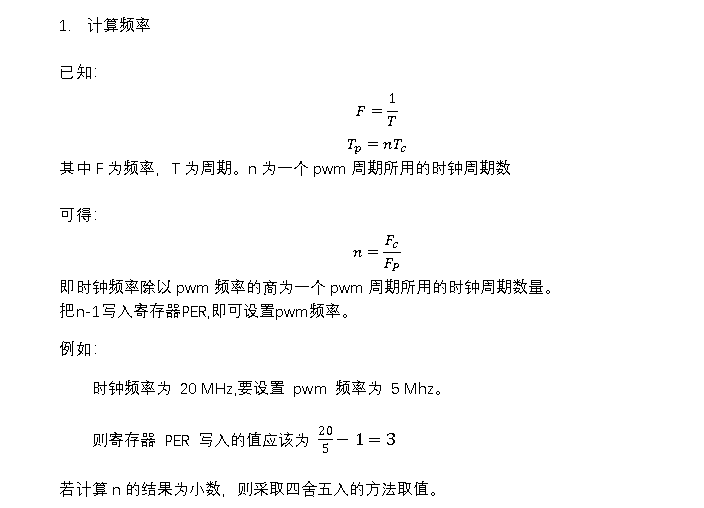
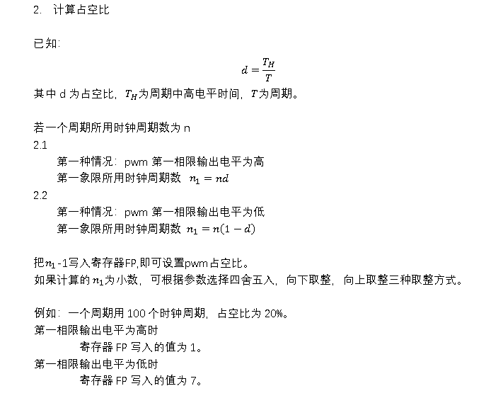
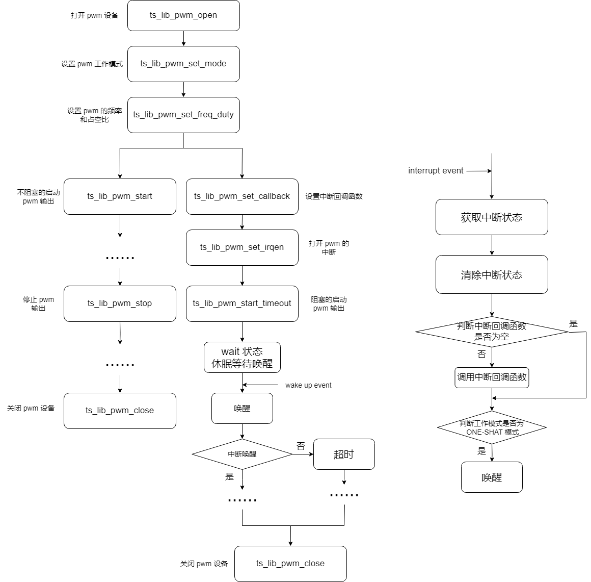

# pwm<u>_</u>设计文档<u>_</u>doppler


|  版本  |  修订日期  | 修订说明 |
| :----: | :--------: | :------: |
| v1.0.0 | 2023-10-18 | 初始版本 |


## 综述


### 缩略语及专有名词


| 缩略语/专有名词 | 对应英文/中文   | 说明                                        |
| --- | --- | --- |
| fpout           | first phase out | 第一个相位的输出电平                        |
| ONE-SHOT 模式   | ONE-SHOT 模式   | 此工作模式 pwm 输出指定的周期数后会自动停止 |
| CONTINUOUS 模式 | CONTINUOUS 模式 | 此工作模式 pwm 连续不断输出                 |


### 原理说明


## 需求规格

### 需求分析

| 序号    | 需求项      | 说明 |
| --- | --- | --- |
| PWM_01 | 中断可配       | 中断可以设置回调函数，可打开/关闭 |
| PWM_02 | 工作模式可配 | 工作模式可设置为 ONE-SHOT 模式和 CONTINUOUS 模式 |
| PWM_03 | 输出第一相位电平可配 | 输出的第一相位电平可配成高电平和低电平 |
| PWM_04 | 输出频率和占空比可配 | 周期可以根据参数配置 |
| PWM_05 | 输出可控制 | 输出可以控制开始和停止 |


### 规格制定

| 序号  | 规格                     | 说明                                                         |
| --- | --- | --- |
| 规格1 | 中断可控制开关           | 接口 ts_lib_pwm_set_irqen 控制中断开关。                     |
|       | 中断回调函数可配置       | 接口 ts_lib_pwm_set_callback 配置中断回调函数，以及回调函数的私有参数。 |
| 规格2 | 工作模式可配置           | 接口 ts_lib_pwm_set_mode 设置工作模式和第一象限输出的电平。  |
| 规格3 | 输出频率和占空比可配     | 接口 ts_lib_pwm_set_freq_duty 配置输出的频率和占空比。       |
|       |                          | 占空比有误差时，可通过接口 ts_lib_pwm_set_freq_duty 的参数 en_duty_adj调整占空比。 |
| 规格4 | 可控制开始输出和停止输出 | 接口 ts_lib_pwm_start 不阻塞的启动 pwm 输出。                |
|       |                          | 接口 ts_lib_pwm_start_timeout 阻塞的启动 pwm ONE-SHOT 模式输出。 |
|       |                          | 接口 ts_lib_pwm_stop 停止 pwm 输出。                         |


## 顶层设计


### 方案对比

#### 方案一 ：stm32 HAL库接口

1. 初始化

```c
HAL_StatusTypeDef HAL_TIM_PWM_Init(TIM_HandleTypeDef *htim);
```

2. 通道配置

```c
HAL_StatusTypeDef HAL_TIM_PWM_ConfigChannel(TIM_HandleTypeDef *htim, TIM_OC_InitTypeDef *sConfig, uint32_t Channel);
```

3. 输出启动

```c
HAL_StatusTypeDef HAL_TIM_PWM_Start(TIM_HandleTypeDef *htim, uint32_t Channel);
```

4. 输出停止

```c
HAL_StatusTypeDef HAL_TIM_PWM_Stop(TIM_HandleTypeDef *htim, uint32_t Channel);
```

#### 方案二

1. 打开/关闭 pwm 设备

```c
ts_s32 ts_lib_pwm_open(ts_char *pc_dev_name);
ts_void ts_lib_pwm_close(ts_s32 s32_handle);
```

2. 通道设置

```c
ts_s32 ts_lib_pwm_set_mode(ts_s32 s32_handle, ts_u32 u32_channel, ts_pwm_mode_en_t en_mode, ts_pwm_fpout_en_t en_fpout);
ts_s32 ts_lib_pwm_set_freq_duty(ts_s32 s32_handle, ts_u32 u32_channel, ts_u32 u32_freq, ts_u32 u32_duty, ts_pwm_duty_adj_en_t en_duty_adj);
```

3. 中断设置

```c
ts_s32 ts_lib_pwm_set_irqen(ts_s32 s32_handle, ts_u32 u32_channel, ts_pwm_irqen_en_t en_irqen);
ts_s32 ts_lib_pwm_set_callback(ts_s32 s32_handle, ts_u32 u32_channel, ts_pwm_irqcb_fp_t fp_cb, ts_void *pv_priv);
```

4. 输出启动

```c
ts_s32 ts_lib_pwm_start(ts_s32 s32_handle, ts_u32 u32_channel, ts_u32 u32_period_count);
ts_s32 ts_lib_pwm_start_timeout(ts_s32 s32_handle, ts_u32 u32_channel, ts_u32 u32_period_count, ts_u32 u32_timeout_ms);
```

5. 输出停止

```c
ts_s32 ts_lib_pwm_stop(ts_s32 s32_handle, ts_u32 u32_channel);
```


#### 分析

| 方案   | 优点                   |
| --- | --- |
| 方案一 |                        |
|        | api 应用简单           |
| 方案二 |                        |
|        | pwm 中断可设置开关     |
|        | pwm 中断回调函数可设置 |

#### 结论

方案一 api 的应用简单。方案二可对每个 pwm 通道设置中断开关，方便用户配置中断。因此采用第二种方案。


### 方案设计

#### 1. 设置频率和占空比

<center></center>
<center></center>
<center></center>

#### 2. 内存管理

在打开设备时申请内存，在关闭设备时释放内存。

根据 pwm 通道数量申请内存的空间。

​		ts_cpl_kmalloc(channels_num * sizeof(type))

### 性能指标


### 对外接口

#### 1. 函数

#### 1.1 ts_lib_pwm_open

1.1.1 描述

打开 pwm 设备。

1.1.2 语法

```c
ts_s32 ts_lib_pwm_open(ts_char *pc_dev_name);
```


1.1.3 参数

| 参数        | 数据类型  | 描述           | 输入/输出 |
| --- | --- | --- | --- |
| pc_dev_name | ts_char * | 驱动设备文件名 | 输入      |


1.1.4 返回值

| 返回值 | 描述         |
| --- | --- |
| >= 0  | 设备句柄     |
| < 0    | 打开设备失败 |


#### 1.2 ts_lib_pwm_close

1.2.1 描述

关闭 pwm 设备句柄。

1.2.2 语法

```c
ts_void ts_lib_pwm_close(ts_s32 s32_handle);
```


1.2.3 参数

| 参数       | 数据类型 | 描述     | 输入/输出 |
| --- | --- | --- | --- |
| s32_handle | ts_s32   | 驱动设备句柄 | 输入      |


1.2.4 返回值

无

#### 1.3 ts_lib_pwm_set_mode

1.3.1 描述

设置 pwm 工作模式

1.3.2 语法

```c
ts_s32 ts_lib_pwm_set_mode(ts_s32 s32_handle, ts_u32 u32_channel, ts_pwm_mode_en_t en_mode, ts_pwm_fpout_en_t en_fpout);
```


1.3.3 参数

| 参数        | 数据类型 | 描述                     | 输入/输出 |
| --- | --- | --- | --- |
| s32_handle  | ts_s32   | 驱动设备句柄            | 输入      |
| u32_channel | ts_u32   | 指定的通道               | 输入      |
| en_mode     | ts_u32   | pwm 的工作模式           | 输入      |
| en_fpout    | ts_u32   | pwm 第一个相位的输出电平 | 输入      |


1.3.4 返回值

| 返回值    | 描述             |
| --- | --- |
| TS_OK     | 设置工作模式成功 |
| TS_ERR    | 其他错误         |
| TS_EINVAL | 参数错误         |
| TS_EBUSY  | pwm 设备忙       |


#### 1.4 ts_lib_pwm_set_freq_duty

1.4.1 描述

设置 pwm 的频率和占空比

1.4.2 语法

```c
ts_s32 ts_lib_pwm_set_freq_duty(ts_s32 s32_handle, ts_u32 u32_channel, ts_u32 u32_freq, ts_u32 u32_duty, ts_pwm_duty_adj_en_t en_duty_adj);
```


1.4.3 参数

| 参数        | 数据类型             | 描述                          | 输入/输出 |
| --- | --- | --- | --- |
| s32_handle  | ts_s32               | 驱动设备句柄                | 输入      |
| u32_channel | ts_u32               | 指定的通道                    | 输入      |
| u32_freq    | ts_u32               | pwm 输出波形的频率(单位：kHz) | 输入      |
| u32_duty    | ts_u32               | 占空比（0-100）               | 输入      |
| en_duty_adj | ts_pwm_duty_adj_en_t | 占空比有误差时调整占空比      | 输入      |


1.4.4 返回值

| 返回值      | 描述         |
| --- | --- |
| TS_OK       | 设置成功     |
| TS_ERR      | 其他错误     |
| TS_EINVAL   | 参数错误     |
| TS_EBUSY    | pwm 设备忙   |
| TS_EPWMMODE | pwm 模式错误 |


#### 1.5 ts_lib_pwm_set_irqen

1.5.1 描述

打开/关闭 pwm 指定通道的中断

1.5.2 语法

```c
ts_s32 ts_lib_pwm_set_irqen(ts_s32 s32_handle, ts_u32 u32_channel, ts_pwm_irqen_en_t en_irqen);
```


1.5.3 参数

| 参数        | 数据类型          | 描述               | 输入/输出 |
| --- | --- | --- | --- |
| s32_handle  | ts_s32            | 驱动设备句柄       | 输入      |
| u32_channel | ts_u32            | 指定的通道         | 输入      |
| en_irqen    | ts_pwm_irqen_en_t | 打开/关闭 pwm 中断 | 输入      |


1.5.4 返回值

| 返回值    | 描述              |
| --- | --- |
| TS_OK     | 打开/关闭中断成功 |
| TS_ERR    | 打开/关闭中断失败 |
| TS_EINVAL | 参数错误          |


#### 1.6 ts_lib_pwm_set_callback

1.6.1 描述

设置 pwm 指定的通道的中断回调函数(只支持 RTOS 使用)

1.6.2 语法

```c
ts_s32 ts_lib_pwm_set_callback(ts_s32 s32_handle, ts_u32 u32_channel, ts_pwm_irqcb_fp_t fp_cb, ts_void *pv_priv);
```


1.6.3 参数

| 参数        | 数据类型          | 描述                 | 输入/输出 |
| --- | --- | --- | --- |
| s32_handle  | ts_s32            | 驱动设备句柄         | 输入      |
| u32_channel | ts_u32            | 指定的通道           | 输入      |
| fp_cb       | ts_pwm_irqcb_fp_t | 回调函数             | 输入      |
| pv_priv     | ts_void *         | 回调函数用的私有参数 | 输入      |


1.6.4 返回值

| 返回值    | 描述                 |
| --- | --- |
| TS_OK     | 设置中断回调函数成功 |
| TS_ERR    | 其他错误             |
| TS_EINVAL | 参数错误             |


#### 1.7 ts_lib_pwm_start

1.7.1 描述

不阻塞的启动 pwm 输出

1.7.2 语法

```c
ts_s32 ts_lib_pwm_start(ts_s32 s32_handle, ts_u32 u32_channel, ts_u32 u32_period_count);
```


1.7.3 参数

| 参数             | 数据类型 | 描述                                                        | 输入/输出 |
| --- | --- | --- | --- |
| s32_handle       | ts_s32   | 驱动设备句柄                                                | 输入      |
| u32_channel      | ts_u32   | 指定的通道                                                  | 输入      |
| u32_period_count | ts_u32   | ONE-SHOT 模式输出的周期数（此参数在 CONTINUOUS 模式下无效） | 输入      |


1.7.4 返回值

| 返回值      | 描述              |
| --- | --- |
| TS_OK       | 启动 pwm 输出成功 |
| TS_ERR      | 其他错误          |
| TS_EINVAL   | 参数错误          |
| TS_EPWMMODE | pwm 模式错误      |


#### 1.8 ts_lib_pwm_start_timeout

1.8.1 描述

阻塞的启动 pwm ONE-SHOT 模式输出

1.8.2 语法

```c
ts_s32 ts_lib_pwm_start_timeout(ts_s32 s32_handle, ts_u32 u32_channel, ts_u32 u32_period_count, ts_u32 u32_timeout_ms);
```


1.8.3 参数

| 参数             | 数据类型 | 描述                                                        | 输入/输出 |
| --- | --- | --- | --- |
| s32_handle       | ts_s32   | 驱动设备句柄                                                | 输入      |
| u32_channel      | ts_u32   | 指定的通道                                                  | 输入      |
| u32_period_count | ts_u32   | ONE-SHOT 模式输出的周期数（此参数在 CONTINUOUS 模式下无效） | 输入      |
| u32_timeout_ms   | ts_u32   | pwm 超时时间（单位：ms）                                    | 输入      |


1.8.4 返回值

| 返回值      | 描述              |
| --- | --- |
| TS_OK       | 启动 pwm 输出成功 |
| TS_ERR      | 其他错误          |
| TS_EINVAL   | 参数错误          |
| TS_EPWMMODE | pwm 模式错误      |


#### 1.9 ts_lib_pwm_stop

1.9.1 描述

停止 pwm 输出

1.9.2 语法

```c
ts_s32 ts_lib_pwm_stop(ts_s32 s32_handle, ts_u32 u32_channel);
```


1.9.3 参数

| 参数        | 数据类型 | 描述         | 输入/输出 |
| --- | --- | --- | --- |
| s32_handle  | ts_s32   | 驱动设备句柄 | 输入      |
| u32_channel | ts_u32   | 指定的通道   | 输入      |


1.9.4 返回值

| 返回值    | 描述              |
| --- | --- |
| TS_OK     | 停止 pwm 输出成功 |
| TS_ERR    | 其他错误          |
| TS_EINVAL | 参数错误          |


### 2. 数据类型

#### 2.1 ts_pwm_mode_en_t

2.1.1 说明

pwm 工作模式

2.1.2 定义

```c
typedef enum ts_pwm_mode_en {
    TS_PWM_MODE_ONESHOT = 1,
    TS_PWM_MODE_CONTINUOUS,

    TS_PWM_MODE_BUTT
} ts_pwm_mode_en_t;
```


2.1.3 成员

| 成员名称                   | 说明            |
| --- | --- |
| TS_PWM_MODE_ONESHOT    | ONE-SHOT 模式   |
| TS_PWM_MODE_CONTINUOUS | CONTINUOUS 模式 |


2.1.4 注意

无

2.1.5 相关数据类型于接口

ts_lib_pwm_set_mode


#### 2.2 ts_pwm_fpout_en_t

2.2.1 说明

PWM 第一个相位的输出电平

2.2.2 定义

```c
typedef enum ts_pwm_fpout_en {
    TS_PWM_PFOUT_LOW = 0,
    TS_PWM_PFOUT_HIGH,

    TS_PWM_PFOUT_BUTT
} ts_pwm_fpout_en_t;
```


2.2.3 成员

| 成员名称              | 说明                 |
| --- | --- |
| TS_PWM_PFOUT_LOW  | 输出第一相位为低电平 |
| TS_PWM_PFOUT_HIGH | 输出第一相位为高电平 |


2.2.4 注意

无

2.2.5 相关数据类型于接口

ts_lib_pwm_set_mode


#### 2.3 ts_pwm_duty_adj_en_t

2.3.1 说明

占空比有误差时的微调配置

2.3.2 定义

```c
typedef enum ts_pwm_duty_adj_en {
    TS_PWM_DUTY_ROUNDING = 0,
    TS_PWM_DUTY_ROUND_DOWN,
    TS_PWM_DUTY_ROUND_UP,

    TS_PWM_DUTY_BUTT
} ts_pwm_duty_adj_en_t;
```


2.3.3 成员

| 成员名称                   | 说明         |
| --- | --- |
| TS_PWM_DUTY_ROUNDING   | 四舍五入调整 |
| TS_PWM_DUTY_ROUND_DOWN | 向下取整调整 |
| TS_PWM_DUTY_ROUND_UP   | 向上取整调整 |


2.3.4 注意

无

2.2.5 相关数据类型于接口

ts_lib_pwm_set_freq_duty


#### 2.4 ts_pwm_irqen_en_t

2.4.1 说明

打开/关闭 pwm 中断

2.4.2 定义

```c
typedef enum ts_pwm_irqen_en {
    TS_PWM_IRQ_DISABLE = 0,
    TS_PWM_IRQ_ENABLE,

    TS_PWM_IRQ_EN_BUTT
} ts_pwm_irqen_en_t;
```


2.4.3 成员

| 成员名称               | 说明          |
| --- | --- |
| TS_PWM_IRQ_DISABLE | 打开 pwm 中断 |
| TS_PWM_IRQ_ENABLE  | 关闭 pwm 中断 |


2.4.4 注意

无

2.4.5 相关数据类型于接口

ts_lib_pwm_set_irqen


#### 2.5 ts_pwm_mode_s_t

2.5.1 说明

pwm 模式结构体

2.5.2 定义

```c
typedef struct ts_pwm_mode_s {
    ts_u32 u32_channel;
    ts_pwm_mode_en_t en_mode;
    ts_pwm_fpout_en_t en_fpout;
} ts_pwm_mode_s_t;
```


2.5.3 成员

| 成员名称    | 说明                     |
| --- | --- |
| u32_channel | pwm 通道                 |
| en_mode     | pwm 工作模式             |
| en_fpout    | pwm 第一个相位的输出电平 |


2.5.4 注意

无

2.5.5 相关数据类型于接口

无


#### 2.6 ts_pwm_freq_duty_s_t

2.6.1 说明

pwm 频率、占空比结构体

2.6.2 定义

```c
typedef struct ts_pwm_freq_duty_s {
    ts_u32 u32_channel;
    ts_u32 u32_freq;
    ts_u32 u32_duty;
    ts_pwm_duty_adj_en_t en_duty_adj;
} ts_pwm_freq_duty_s_t;
```


2.6.3 成员

| 成员名称    | 说明                         |
| --- | --- |
| u32_channel | pwm 通道                     |
| u32_freq    | pwm 输出波形的频率           |
| u32_duty    | pwm 占空比                   |
| en_duty_adj | pwm 占空比有误差时的微调配置 |


2.6.4 注意

无

2.6.5 相关数据类型于接口

无


#### 2.7 ts_pwm_irqen_s_t

2.7.1 说明

pwm 中断使能配置

2.7.2 定义

```c
typedef struct ts_pwm_irqen_s {
    ts_u32 u32_channel;
    ts_pwm_irqen_en_t en_irqen;
} ts_pwm_irqen_s_t;
```


2.7.3 成员

| 成员名称    | 说明               |
| --- | --- |
| u32_channel | pwm 通道           |
| en_irqen    | 打开/关闭 pwm 中断 |


2.7.4 注意

无

2.7.5 相关数据类型于接口

无


#### 2.8 ts_pwm_irqcb_attr_s_t

2.8.1 说明

pwm 中断回调属性

2.8.2 定义

```c
typedef struct ts_pwm_irqcb_attr_s {
    ts_u32 u32_channel;
    ts_pwm_irqcb_fp_t fp_irqcb;
    void *pv_priv;
} ts_pwm_irqcb_attr_s_t;
```


2.8.3 成员

| 成员名称 | 说明                       |
| --- | --- |
| fp_irqcb | pwm 中断回调函数           |
| pv_priv  | pwm 中断回调函数的私有参数 |

2.8.4 注意

无

2.8.5 相关数据类型于接口

无


#### 2.9 ts_pwm_output_s_t

2.9.1 说明

pwm 输出结构体

2.9.2 定义

```c
typedef struct ts_pwm_output_s {
    ts_u32 u32_channel;
    ts_u32 u32_period_count;
    ts_u32 u32_timeout_ms;
} ts_pwm_output_s_t;
```


2.9.3 成员

| 成员名称         | 说明                          |
| --- | --- |
| u32_channel      | pwm 通道                      |
| u32_period_count | pwm ONE-SHOT 模式输出的周期数 |
| u32_timeout_ms   | pwm 超时时间（单位：ms）      |

2.9.4 注意

无

2.9.5 相关数据类型于接口

无


#### 2.10 ts_pwm_irqcb_fp_t

2.10.1 说明

中断回调函数

2.10.2 定义

```c
typedef ts_void (*ts_pwm_irqcb_fp_t) (ts_u32, ts_void *);
```

2.10.3 成员

无

2.10.4 注意

无

2.10.5  相关数据类型于接口

ts_tdl_pwm_set_callback


#### 3. 错误码

pwm 特殊错误码如下表所示：

| 错误代码   | 宏定义      | 说明         |
| --- | --- | --- |
| 0x5B035001 | TS_EPWMMODE | pwm 模式错误 |


## 模块设计

<center></center>