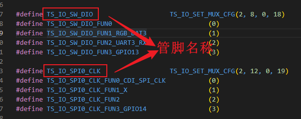
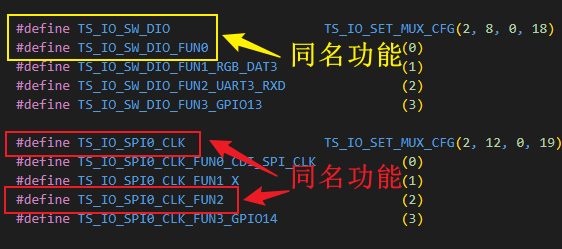
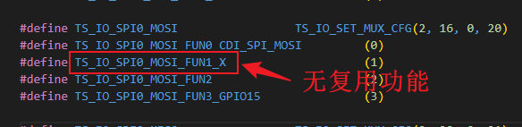
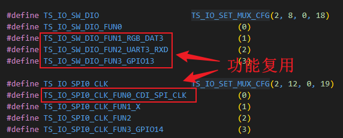

## GPIO

### 概述

GPIO 库实现芯片 IO 复用关系设置，输入输出配置等功能。

#### 管脚定义说明

管脚定义分管脚名称和管脚功能两个方面，管脚名称一般为此管脚复用关系中的一个，而管脚功能则区分在此

管脚上的功能复用关系。

- 管脚名称格式为 `TS_IO_XXX_XXX`, 不会带 `FUN` 字样

举例说明：

<center></center>

- 与管脚名称同名的功能复用定义， 为 `TS_IO_XXX_XXX_FUN` 加功能序号

举例说明：

<center></center>

- 无复用功能，则结尾必然带一个 `_X`

举例说明：

<center></center>

- 普通复用功能定义 `TS_IO_XXX_XXX_FUNx` 加功能名称

举例说明：

<center></center>

### API 说明

| 函数名 | 用途说明 |
| --- | --- |
| [ts_lib_gpio_init](#ts_lib_gpio_init) | 初始化 GPIO 库 |
| [ts_lib_gpio_deinit](#ts_lib_gpio_deinit) | GPIO 库去初始化 |
| [ts_lib_gpio_set_mux](#ts_lib_gpio_set_mux) | 设置芯片管脚的复用关系 |
| [ts_lib_gpio_set_pull](#ts_lib_gpio_set_pul ) | 设置芯片管脚的上下拉 |
| [ts_lib_gpio_set_o_strong](#ts_lib_gpio_set_o_strong) | 设置芯片管脚的输出强度 |
| [ts_lib_gpio_set_sr](#ts_lib_gpio_set_sr) | 设置芯片管脚的摆率 |
| [ts_lib_gpio_set_schmitt](#ts_lib_gpio_set_schmitt) | 设置芯片管脚的施密特触发器是否使能 |
| [ts_lib_gpio_set_attr](#ts_lib_gpio_set_attr) | 设置 GPIO 的输入输出属性 |
| [ts_lib_gpio_set_irq_attr](#ts_lib_gpio_set_irq_attr ) | 设置 GPIO 的中断属性 |
| [ts_lib_gpio_read_pin](#ts_lib_gpio_read_pin) | 读取指定 GPIO 管脚的电平状态 |
| [ts_lib_gpio_write_pin](#ts_lib_gpio_write_pin) | 写指定 GPIO 管脚的电平状态 |
| [ts_lib_gpio_flip_pin](#ts_lib_gpio_flip_pin) | 翻转指定 GPIO 管脚的电平状态 |
| [ts_lib_gpio_read_grp](#ts_lib_gpio_read_grp) | 读取指定一组的 GPIO 管脚的电平状态 |
| [ts_lib_gpio_write_grp](#ts_lib_gpio_write_grp) | 写指定一组的 GPIO 管脚的电平状态 |
| [ts_lib_gpio_flip_grp](#ts_lib_gpio_flip_grp) | 翻转指定一组的 GPIO 管脚的电平状态 |

#### ts_lib_gpio_init

##### 描述

初始化 GPIO 库，其余接口需此函数完成正常调用后，才可以使用。

##### 语法

```c
ts_s32 ts_lib_gpio_init(ts_void)
```

##### 参数

无

##### 返回值

| 返回值 | 描述 |
| --- | --- |
| TS_OK | 初始化成功 |
| TS_ERR | 初始化失败 |

##### 版本差异

| 版本号 | 差异       |
| --- | --- |
| V100   | 支持此功能 |

##### 依赖

- 头文件 gpio_v100.h
- 库文件 ts_otdk.a

##### 注意

初始化库时，打开的 GPIO 设备名为: `/dev/gpio` , 如改动 GPIO 驱动，

请注意设备注册名。

##### 举例

```c
ts_s32 s32_ret;

ts_cpl_insmod(gpio, ts_null);
s32_ret = ts_lib_gpio_init();
if (s32_ret != TS_OK)
    printf("Failed to init the libgpio!\n");
```

##### 相关主题

[ts_lib_gpio_deinit ](#ts_lib_gpio_deinit)

#### ts_lib_gpio_deinit 

##### 描述

GPIO 库去初始化

##### 语法

```c
ts_s32 ts_lib_gpio_deinit(ts_void)
```

##### 参数

无

##### 返回值

| 返回值 | 描述 |
| --- | --- |
| TS_OK | 去初始化成功 |

##### 版本差异

| 版本号 | 差异       |
| --- | --- |
| V100   | 支持此功能 |

##### 依赖

- 头文件 gpio_v100.h
- 库文件 ts_otdk.a

##### 注意

无

##### 举例

无

##### 相关主题

[ts_lib_gpio_init](#ts_lib_gpio_init)

#### ts_lib_gpio_set_mux

##### 描述

因芯片管脚总数限制，一般每个芯片管脚都会复用一到三个其他功能，此函数实现设置芯片管脚的复用关系。

约定:

- 管脚名

即芯片管脚名称，一般为此管脚的默认功能定义

- 功能名

即此管脚实现的具体功能名称

##### 语法

```c
ts_void ts_lib_gpio_set_mux(ts_u32 u32_ioname, ts_u32 u32_func)
```

##### 参数

| 参数 | 数据类型 | 描述 | 输入/输出 |
| --- | --- | --- | --- |
| u32_ioname  | ts_u32 | 管脚名称 | 输入 |
| u32_func | ts_u32 | 指定功能 | 输入 |

##### 返回值

无

##### 版本差异

| 版本号 | 差异       |
| --- | --- |
| V100   | 支持此功能 |

##### 依赖

- 头文件 gpio_v100.h iomux.h

- 库文件 ts_otdk.a

##### 注意

此函数内部不会对输入管脚名称和管脚功能定义做匹配检测，需调用者严格根据 iomux.h 中定义

的范围进行配置。

##### 举例

摘自 iomux.h 中的部分定义
```h
#define TS_IO_SPI1_MISO                 TS_IO_SET_MUX_CFG(3, 16, 0, 28)
#define TS_IO_SPI1_MISO_FUN0                      (0)
#define TS_IO_SPI1_MISO_FUN1_SR_OUT_DAT9          (1)
#define TS_IO_SPI1_MISO_FUN2_SPI_SLV_MISO         (2)
#define TS_IO_SPI1_MISO_FUN3_GPIO23               (3)

#define TS_IO_PWM0                      TS_IO_SET_MUX_CFG(4, 16, 1, 4)
#define TS_IO_PWM0_FUN0                           (0)
#define TS_IO_PWM0_FUN1_X                         (1)
#define TS_IO_PWM0_FUN2_X                         (2)
#define TS_IO_PWM0_FUN3_GPIO30                    (3)

#define TS_IO_PWM1                      TS_IO_SET_MUX_CFG(4, 20, 1, 5)
#define TS_IO_PWM1_FUN0                           (0)
#define TS_IO_PWM1_FUN1_X                         (1)
#define TS_IO_PWM1_FUN2_X                         (2)
#define TS_IO_PWM1_FUN3_GPIO31                    (3)
```


```c
ts_lib_gpio_set_mux(TS_IO_SPI1_MISO, TS_IO_SPI1_MISO_FUN3_GPIO23);
ts_lib_gpio_set_mux(TS_IO_PWM0, TS_IO_PWM0_FUN3_GPIO30);
ts_lib_gpio_set_mux(TS_IO_PWM1, TS_IO_PWM1_FUN3_GPIO31);
```

##### 相关主题

无

#### ts_lib_gpio_set_pull

##### 描述

设置芯片管脚的上下拉情况，并不局限与单独的 GPIO 功能，对同一组的复用功能都生效。

可以设置成上拉，下拉以及无上下拉状态。

##### 语法

```c
ts_void ts_lib_gpio_set_pull(ts_u32 u32_ioname, ts_elec_level_en_t en_lvl)
```

##### 参数

| 参数 | 数据类型 | 描述 | 输入/输出 |
| --- | --- | --- | --- |
| u32_ioname  | ts_u32 | 管脚名称 | 输入 |
| en_lvl | ts_elec_level_en_t | 指定电平 | 输入 |

##### 返回值

无

##### 版本差异

| 版本号 | 差异       |
| --- | --- |
| V100   | 支持此功能 |

##### 依赖

- 头文件 gpio_v100.h iomux.h ts_comm.h

- 库文件 ts_otdk.a

##### 注意

仅支持以下三种电平状态：

- 高电平(TS_ELEC_LVL_HI)

- 低电平(TS_ELEC_LVL_LO)

- 高阻(TS_ELEC_LVL_Z)

##### 举例

```C
ts_lib_gpio_set_pull(TS_IO_SPI0_WP, TS_ELEC_LVL_LO);
ts_lib_gpio_set_pull(TS_IO_SPI0_HOLD, TS_ELEC_LVL_HI);
ts_lib_gpio_set_pull(TS_IO_SPI0_CSN0, TS_ELEC_LVL_Z);
```

##### 相关主题

无

#### ts_lib_gpio_set_o_strong

##### 描述

设置输出强度，仅适用与 GPIO 输出功能，强度共分 4 级。

##### 语法

```c
ts_void ts_lib_gpio_set_o_strong(ts_u32 u32_ioname, ts_u32 u32_str)
```

##### 参数

| 参数        | 数据类型          | 描述               | 输入/输出 |
| --- | --- | --- | --- |
| u32_ioname | ts_u32 | 管脚名称 | 输入 |
| u32_str | ts_u32 | 指定输出强度，范围 [0..3] | 输入 |

##### 返回值

无

##### 版本差异

| 版本号 | 差异       |
| --- | --- |
| V100   | 支持此功能 |

##### 依赖

- 头文件 gpio_v100.h iomux.h

- 库文件 ts_otdk.a

##### 注意

无

##### 举例

```C
ts_lib_gpio_set_o_strong(TS_IO_SPI0_WP, 0);
ts_lib_gpio_set_o_strong(TS_IO_SPI0_HOLD, 1);
ts_lib_gpio_set_o_strong(TS_IO_SPI0_CSN0, 2);
```

##### 相关主题

无

#### ts_lib_gpio_set_sr

##### 描述

每一个 I/O 都可以通过此函数配置此 I/O 的摆率，摆率控制会影响到 I/O 的上升沿和下降沿。

提供高摆率和低摆率两种选择，区别如下：

- 高摆率: 提供信号高速转换，但是可能引入噪声和串扰

- 低摆率: 可降低噪声和串扰，但是会增加上升沿和下降沿的延时

##### 语法

```c
ts_void ts_lib_gpio_set_sr(ts_u32 u32_ioname, ts_gpio_sr_en_t en_sr)
```

##### 参数

| 参数 | 数据类型 | 描述 | 输入/输出 |
| --- | --- | --- | --- |
| u32_ioname | ts_u32 | 管脚名称 | 输入 |
| u32_str | ts_gpio_sr_en_t | 指定摆率速度 | 输入 |

##### 返回值

无

##### 版本差异

| 版本号 | 差异       |
| --- | --- |
| V100   | 支持此功能 |

##### 依赖

- 头文件 gpio_v100.h iomux.h

- 库文件 ts_otdk.a

##### 注意

无

##### 举例

```C
ts_lib_gpio_set_sr(TS_IO_SPI0_WP, TS_GPIO_SR_SLOW);
ts_lib_gpio_set_sr(TS_IO_SPI0_HOLD, TS_GPIO_SR_FAST);
ts_lib_gpio_set_sr(TS_IO_SPI0_CSN0, TS_GPIO_SR_SLOW);
```

##### 相关主题

[ts_gpio_sr_en_t](#ts_gpio_sr_en_t)


#### ts_lib_gpio_set_schmitt

##### 描述

施密特触发器是一种波形整形电路，在输入电压高于上阈值时，输出高电平(1)，在输入电压低于下阈值时，才会输出低电平(0)。

##### 语法

```c
ts_void ts_lib_gpio_set_schmitt(ts_u32 u32_ioname, ts_option_en_t en_opt)
```

##### 参数

| 参数 | 数据类型 | 描述 | 输入/输出 |
| --- | --- | --- | --- |
| u32_ioname | ts_u32 | 管脚名称 | 输入 |
| en_opt | ts_option_en_t | 是否使能 | 输入 |

##### 返回值

无

##### 版本差异

| 版本号 | 差异       |
| --- | --- |
| V100   | 支持此功能 |

##### 依赖

- 头文件 gpio_v100.h iomux.h

- 库文件 ts_otdk.a

##### 注意

仅对输入有效

##### 举例

无

##### 相关主题

无

#### ts_lib_gpio_set_attr

##### 描述

设置 GPIO 属性。

##### 语法

```c
ts_s32 ts_lib_gpio_set_attr(ts_gpio_attr_s_t *pst_attr)
```

##### 参数

| 参数 | 数据类型 | 描述 | 输入/输出 |
| --- | --- | --- | --- |
| pst_attr | ts_gpio_attr_s_t * | 管脚属性 | 输入 |

##### 返回值

| 返回值 | 描述 |
| --- | --- |
| TS_OK | 设置成功 |
| -TS_ENOINIT | GPIO 库未初始化 |
| -TS_ENULLPTR | pst_attr 为空指针 |
| -TS_EINVALGRPID | 管脚错误 |

##### 版本差异

| 版本号 | 差异       |
| --- | --- |
| V100   | 支持此功能 |

##### 依赖

- 头文件 gpio_v100.h

- 库文件 ts_otdk.a

##### 注意

无

##### 举例

```c
tdk_sensor_cfg_s_t gst_snr_cfg;

ts_s32 snr_gpio_cfg2out(ts_s32 s32_gpio_num, ts_elec_level_en_t en_o_def)
{
    ts_gpio_attr_s_t st_attr;

    /* 无需程序控制，直接返回成功 */
    if (-1 == s32_gpio_num)
        return TS_OK;

    st_attr.u32_pin_no = (ts_u32)s32_gpio_num;
    st_attr.en_dir = TS_GPIO_DIR_OUTPUT;
    if (TS_ELEC_LVL_LO == en_o_def)
        st_attr.en_lvl = TS_ELEC_LVL_LO;
    else
        st_attr.en_lvl = TS_ELEC_LVL_HI;

    return ts_lib_gpio_set_attr((ts_gpio_attr_s_t *)&st_attr);
}

ts_void snr_gpio_set_out_lvl(ts_s32 s32_gpio_num, ts_elec_level_en_t en_o_lvl)
{
    ts_elec_level_en_t en_lvl;

    /* 无需程序控制，直接返回成功 */
    if (-1 == s32_gpio_num)
        return;

    if (TS_ELEC_LVL_LO == en_o_lvl)
        en_lvl = TS_ELEC_LVL_LO;
    else
        en_lvl = TS_ELEC_LVL_HI;
    
    ts_lib_gpio_write_pin((ts_u32)s32_gpio_num, en_lvl);
}


ts_void tdk_snrcfg_init(tdk_sensor_cfg_s_t *pst_cfg)
{
    if (ts_null == pst_cfg) {
        printf("pst_cfg is ts_null\n");

        return;
    }

    /* 管脚配置成输出 */
    snr_gpio_cfg2out(pst_cfg->s32_pwr_gpio_num, pst_cfg->en_pwr_off_lvl);
    snr_gpio_cfg2out(pst_cfg->s32_rst_gpio_num, pst_cfg->en_reset_lvl);
    snr_gpio_cfg2out(pst_cfg->s32_sht_p_gpio_num, TS_ELEC_LVL_LO);
    snr_gpio_cfg2out(pst_cfg->s32_sht_n_gpio_num, TS_ELEC_LVL_LO);
}


ts_void tdk_snrcfg_set_for_demo(ts_void)
{
     /* 配置探测器复位、电源、开门的 IO 控制信息 */
    gst_snr_cfg.s32_pwr_gpio_num = -1;
    gst_snr_cfg.s32_rst_gpio_num = -1;
    gst_snr_cfg.s32_sht_p_gpio_num = 30;
    gst_snr_cfg.s32_sht_n_gpio_num = 31;
    gst_snr_cfg.u32_sht_dbg = 1;
    gst_snr_cfg.u32_sht_hold = 50000;

    tdk_snrcfg_init((tdk_sensor_cfg_s_t *)&gst_snr_cfg);
}
```

##### 相关主题

[ts_lib_gpio_write_pin](#ts_lib_gpio_write_pin)

[ts_gpio_attr_s_t](#ts_gpio_attr_s_t)

[ts_gpio_dir_en_t](#ts_gpio_dir_en_t)

#### ts_lib_gpio_set_irq_attr

##### 描述

设置 GPIO 的中断属性,如无需中断处理，可无需配置

##### 语法

```c
ts_s32 ts_lib_gpio_set_irq_attr(ts_gpio_irq_attr_s_t *pst_irq_attr)
```

##### 参数

| 参数 | 数据类型 | 描述 | 输入/输出 |
| --- | --- | --- | --- |
| pst_irq_attr | ts_gpio_irq_attr_s_t * | 管脚中断属性 | 输入 |

##### 返回值

| 返回值 | 描述 |
| --- | --- |
| TS_OK | 设置成功 |
| -TS_ENOINIT | GPIO 库未初始化 |
| -TS_ENULLPTR | pst_attr 为空指针或者中断回调函数为空指针 |
| -TS_EINVALGRPID | 管脚错误 |

##### 版本差异

| 版本号 | 差异       |
| --- | --- |
| V100   | 支持此功能 |

##### 依赖

- 头文件 gpio_v100.h

- 库文件 ts_otdk.a

##### 注意

无

##### 举例

```C
ts_void gpio12_cb(ts_void)
{
    printf("%s->%d\n", __func__, __LINE__);
}

ts_void gpio_demo(ts_void)
{
    ts_gpio_attr_s_t st_gpio;
    ts_gpio_irq_attr_s_t st_irq_attr;

    st_gpio.u32_pin_no = 12;
    st_gpio.en_dir = TS_GPIO_DIR_INPUT;
    st_gpio.en_debounce_en = TS_OPT_ENABLE;
    st_gpio.en_lvl = TS_ELEC_LVL_LO;
    ts_lib_gpio_set_attr((ts_gpio_attr_s_t *)&st_gpio);

    st_gpio.u32_pin_no = 13;
    st_gpio.en_dir = TS_GPIO_DIR_INPUT;
    st_gpio.en_debounce_en = TS_OPT_DISABLE;
    st_gpio.en_lvl = TS_ELEC_LVL_HI;
    ts_lib_gpio_set_attr((ts_gpio_attr_s_t *)&st_gpio);

    ts_lib_gpio_set_mux(TS_IO_SW_CLK, TS_IO_SW_CLK_FUN3_GPIO12);
    ts_lib_gpio_set_mux(TS_IO_SW_DIO, TS_IO_SW_DIO_FUN3_GPIO13);

    st_irq_attr.u32_pin_no = 12;
    st_irq_attr.en_irq_type = TS_ELEC_LVL_REDGE;
    st_irq_attr.en_irqen = TS_OPT_ENABLE;
    st_irq_attr.fp_irqcb = gpio12_cb;

    ts_lib_gpio_set_irq_attr((ts_gpio_irq_attr_s_t *)&st_irq_attr);
}
```

##### 相关主题

[ts_gpio_irq_attr_s_t](#ts_gpio_irq_attr_s_t)

#### ts_lib_gpio_read_pin

##### 描述

读指定管脚的电平状态

##### 语法

```c
ts_s32 ts_lib_gpio_read_pin(ts_u32 u32_pin_no)
```

##### 参数

| 参数 | 数据类型 | 描述 | 输入/输出 |
| --- | --- | --- | --- |
| u32_pin_no | ts_u32 | 管脚编号 | 输入 |

##### 返回值

| 返回值 | 描述 |
| --- | --- |
| 0 | 低电平 |
| 1 | 高电平 |
| -TS_ENOINIT | GPIO 库未初始化 |
| -TS_EINVALGRPID | 管脚错误 |

##### 版本差异

| 版本号 | 差异 |
| --- | --- | 
| V100   | 支持此功能 |

##### 依赖

- 头文件 gpio_v100.h

- 库文件 ts_otdk.a

##### 注意

- 管脚序号与芯片管脚定义保持一致，如管脚定义为 `GPIO50`, 则 `u32_pin_no` 需配置成 `50`

##### 举例

```c
ts_u32 u32_pin_no;
ts_s32 s32_ret;

u32_pin_no = 50
s32_ret = ts_lib_gpio_read_pin(u32_pin_no);
if (s32_ret >= 0)
    printf("pin=%d\n", s32_ret);
else
    printf("Failed to read pin %d, ret = %d\n", u32_pin_no, s32_ret);
```

##### 相关主题

无

#### ts_lib_gpio_write_pin

##### 描述

写指定的 GPIO 管脚电平

##### 语法

```c
ts_s32 ts_lib_gpio_write_pin(ts_u32 u32_pin_no, ts_elec_level_en_t en_lvl)
```

##### 参数

| 参数 | 数据类型 | 描述 | 输入/输出 |
| --- | --- | --- | --- |
| u32_pin_no | ts_u32 | 管脚编号 | 输入 |
| en_lvl | ts_elec_level_en_t | 电平值 | 输入 |

##### 返回值

| 返回值 | 描述 |
| --- | --- |
| TS_OK | 写成功 |
| -TS_ENOINIT | GPIO 库未初始化 |
| -TS_EINVALGRPID | 管脚错误 |

##### 版本差异

| 版本号 | 差异       |
| --- | --- |
| V100   | 支持此功能 |

##### 依赖

- 头文件 gpio_v100.h

- 库文件 ts_otdk.a

##### 注意

- 管脚序号与芯片管脚定义保持一致，如管脚定义为 `GPIO50`, 则 `u32_pin_no` 需配置成 `50`

- 仅对输出管脚生效

##### 举例

参见 [ts_lib_gpio_set_attr](#ts_lib_gpio_set_attr) 中的举例

##### 相关主题

[ts_lib_gpio_set_attr](#ts_lib_gpio_set_attr)


#### ts_lib_gpio_flip_pin

##### 描述

翻转指定管脚的电平状态，即低电平翻转到高电平，而高电平翻转到低电平

##### 语法

```c
ts_s32 ts_lib_gpio_flip_pin(ts_u32 u32_pin_no)
```

##### 参数

| 参数 | 数据类型 | 描述 | 输入/输出 |
| --- | --- | --- | --- |
| u32_pin_no | ts_u32 | 管脚编号 | 输入 |

##### 返回值

| 返回值 | 描述 |
| --- | --- |
| TS_OK | 翻转成功 |
| -TS_ENOINIT | GPIO 库未初始化 |
| -TS_EINVALGRPID | 管脚错误 |

##### 版本差异

| 版本号 | 差异       |
| --- | --- |
| V100   | 支持此功能 |

##### 依赖

- 头文件 gpio_v100.h

- 库文件 ts_otdk.a

##### 注意

- 管脚序号与芯片管脚定义保持一致，如管脚定义为 `GPIO50`, 则 `u32_pin_no` 需配置成 `50`

- 仅对输出管脚生效

##### 举例

无

##### 相关主题

无


#### ts_lib_gpio_read_grp

##### 描述

读整组(Bank)的全部或者部分指定管脚电平状态

##### 语法

```c
ts_s32 ts_lib_gpio_read_grp(ts_u32 u32_grp_idx, ts_u32 u32_pin_idx, ts_u32 *pu32_val)
```

##### 参数

| 参数 | 数据类型 | 描述 | 输入/输出 |
| --- | --- | --- | --- |
| u32_grp_idx | ts_u32 | GPIO 组序号 | 输入 |
| u32_pin_idx | ts_u32 | 一组内的管脚，32 Bit 对应 32 个管脚 | 输入 |
| pu32_val | ts_u32 * | 读到的电平值 | 输出 |

##### 返回值

| 返回值 | 描述 |
| --- | --- |
| TS_OK | 翻转成功 |
| -TS_ENULLPTR | pu32_val 为空指针 |
| -TS_ENOINIT | GPIO 库未初始化 |
| -TS_EINVALGRPID | u32_grp_idx 错误 |

##### 版本差异

| 版本号 | 差异       |
| --- | --- |
| V100   | 支持此功能 |

##### 依赖

- 头文件 gpio_v100.h

- 库文件 ts_otdk.a

##### 注意

无

##### 举例

- 读写第 0 组整组电平状态

```C
ts_s32 s32_ret;
ts_u32 u32_val;

s32_ret = ts_lib_gpio_write_grp(0, 0xFFFFFFFF, 0x55aa55aa);
if (TS_OK == s32_ret) {
    s32_ret = ts_lib_gpio_read_grp(0, 0xFFFFFFFF, (ts_u32 *)&u32_val);
    printf("ret=%d, val=%x\n", s32_ret, u32_val);
}

```

- 仅读写取第 0 组 第 0, 11 这两个管脚的状态, 0 脚配置成高电平， 11 则为低电平

```c
ts_s32 s32_ret;
ts_u32 u32_val;

s32_ret = ts_lib_gpio_write_grp(0, (TS_GPIO_BANK0_0 | TS_GPIO_BANK0_11), TS_GPIO_BANK0_0);
if (TS_OK == s32_ret) {
    s32_ret = ts_lib_gpio_read_grp(0, (TS_GPIO_BANK0_0 | TS_GPIO_BANK0_11), (ts_u32 *)&u32_val);
    printf("ret=%d, val=%x\n", s32_ret, u32_val);
}
```

##### 相关主题

[ts_lib_gpio_write_grp](#ts_lib_gpio_write_grp)


#### ts_lib_gpio_write_grp

##### 描述

写整组(Bank)的全部或者部分指定管脚电平状态

##### 语法

```c
ts_s32 ts_lib_gpio_write_grp(ts_u32 u32_grp_idx, ts_u32 u32_pin_idx, ts_u32 u32_val)
```

##### 参数

| 参数 | 数据类型 | 描述 | 输入/输出 |
| --- | --- | --- | --- |
| u32_grp_idx | ts_u32 | GPIO 组序号 | 输入 |
| u32_pin_idx | ts_u32 | 一组内的管脚，32 Bit 对应 32 个管脚 | 输入 |
| u32_val | ts_u32 | 写入值 | 输入 |

##### 返回值

| 返回值 | 描述 |
| --- | --- |
| TS_OK | 写成功 |
| -TS_ENOINIT | GPIO 库未初始化 |
| -TS_EINVALGRPID | u32_grp_idx 错误 |

##### 版本差异

| 版本号 | 差异       |
| --- | --- |
| V100   | 支持此功能 |

##### 依赖

- 头文件 gpio_v100.h

- 库文件 ts_otdk.a

##### 注意

无

##### 举例

参见 [ts_lib_gpio_read_grp](#ts_lib_gpio_read_grp) 中的举例

##### 相关主题

[ts_lib_gpio_read_grp](#ts_lib_gpio_read_grp)

#### ts_lib_gpio_flip_grp

##### 描述

翻转整组(Bank)的全部或者部分指定管脚电平状态

##### 语法

```c
ts_s32 ts_lib_gpio_flip_grp(ts_u32 u32_grp_idx, ts_u32 u32_pin_idx)
```

##### 参数

| 参数 | 数据类型 | 描述 | 输入/输出 |
| --- | --- | --- | --- |
| u32_grp_idx | ts_u32 | GPIO 组序号 | 输入 |
| u32_pin_idx | ts_u32 | 一组内的管脚，32 Bit 对应 32 个管脚 | 输入 |

##### 返回值

| 返回值 | 描述 |
| --- | --- |
| TS_OK | 翻转成功 |
| -TS_ENOINIT | GPIO 库未初始化 |
| -TS_EINVALGRPID | u32_grp_idx 错误 |

##### 版本差异

| 版本号 | 差异       |
| --- | --- |
| V100   | 支持此功能 |

##### 依赖

- 头文件 gpio_v100.h

- 库文件 ts_otdk.a

##### 注意

无

##### 举例

无

##### 相关主题

无


### 数据类型

| 数据类型 | 用途说明 |
| --- | --- |
| [ts_gpio_dir_en_t](#ts_gpio_dir_en_t) | 方向定义 |
| [ts_gpio_sr_en_t](#ts_gpio_sr_en_t) | 摆率定义 |
| [ts_gpio_irq_attr_s_t](#ts_gpio_irq_attr_s_t) | 中断属性结构体 |
| [ts_gpio_attr_s_t](#ts_gpio_attr_s_t) | GPIO 管脚属性结构体 |

#### ts_gpio_dir_en_t

##### 说明

GPIO 输出输入方向定义

##### 定义

```c
typedef enum ts_gpio_dir_en {
    TS_GPIO_DIR_INPUT = 0,
    TS_GPIO_DIR_OUTPUT = 1,
    TS_GPIO_DIR_BUTT
} ts_gpio_dir_en_t;
```

##### 成员

| 成员名称 | 说明 |
| --- | --- |
| TS_GPIO_DIR_INPUT | 输入方向 |
| TS_GPIO_DIR_OUTPUT | 输出方向 |

##### 注意

无

##### 相关数据类型与接口

[ts_lib_gpio_set_attr](#ts_lib_gpio_set_attr)

#### ts_gpio_sr_en_t

##### 说明

摆率定义

##### 定义

```c
typedef enum ts_gpio_sr_en {
    TS_GPIO_SR_SLOW = 0,
    TS_GPIO_SR_FAST = 1,

    TS_GPIO_SR_BUTT
} ts_gpio_sr_en_t;
```

##### 成员

| 成员名称 | 说明 |
| --- | --- |
| TS_GPIO_SR_SLOW  | 低摆率 |
| TS_GPIO_SR_FAST | 高速摆率 |

##### 注意

无

##### 相关数据类型与接口

[ts_lib_gpio_set_sr](#ts_lib_gpio_set_sr)

#### ts_gpio_irq_attr_s_t

##### 说明

GPIO 中断属性结构体。

##### 定义

```c
typedef struct ts_gpio_irq_attr_s {
    ts_u32 u32_pin_no;
    ts_option_en_t en_irqen;
    ts_elec_level_en_t en_irq_type;
    ts_gpio_irqcb_t fp_irqcb;
} ts_gpio_irq_attr_s_t;
```

##### 成员

| 成员名称 | 说明 |
| --- | --- |
| u32_pin_no | 指定 GPIO 序号 |
| en_irqen | 中断是否使能， 取值为: TS_OPT_DISABLE 或者 TS_OPT_ENABLE |
| en_irq_type | 中断类型 |
| fp_irqcb | 中断回调函数 |

##### 注意

- 管脚序号与芯片管脚定义保持一致，如管脚定义为 `GPIO50`, 则 `u32_pin_no` 需配置成 `50`

- 中断类型(en_irq_type)，支持以下五种：

TS_ELEC_LVL_LO: 低电平
TS_ELEC_LVL_HI: 高电平
TS_ELEC_LVL_REDGE: 上升沿
TS_ELEC_LVL_FEDGE: 下降沿
TS_ELEC_LVL_BEDGE: 双沿

- 中断回调函数定义如下:

`typedef ts_void (*ts_gpio_irqcb_t) (ts_void);`


##### 相关数据类型与接口

[ts_lib_gpio_set_irq_attr](#ts_lib_gpio_set_irq_attr)

#### ts_gpio_attr_s_t

##### 说明

GPIO 管脚属性结构体

##### 定义

```c
typedef struct ts_gpio_attr_s {
    ts_u32 u32_pin_no;
    ts_gpio_dir_en_t en_dir;
    ts_option_en_t en_debounce_en;
    ts_elec_level_en_t en_lvl;
} ts_gpio_attr_s_t;
```

##### 成员

| 成员名称 | 说明 |
| --- | ---- |
| u32_pin_no | 管脚序号 |
| en_dir | 管脚方向 |
| en_debounce_en | 消抖使能, 取值为: TS_OPT_DISABLE 或者 TS_OPT_ENABLE |
| en_lvl | 初始值，输出方向有效 |

##### 注意

- 管脚序号与芯片管脚定义保持一致，如管脚定义为 `GPIO50`, 则 `u32_pin_no` 需配置成 `50`

- en_lvl 是 GPIO 在设置成输出时，初始默认输出的电平

##### 相关数据类型与接口

[ts_lib_gpio_set_attr](#ts_lib_gpio_set_attr)

[ts_gpio_sr_en_t](#ts_gpio_sr_en_t)


### 错误码

无

----
