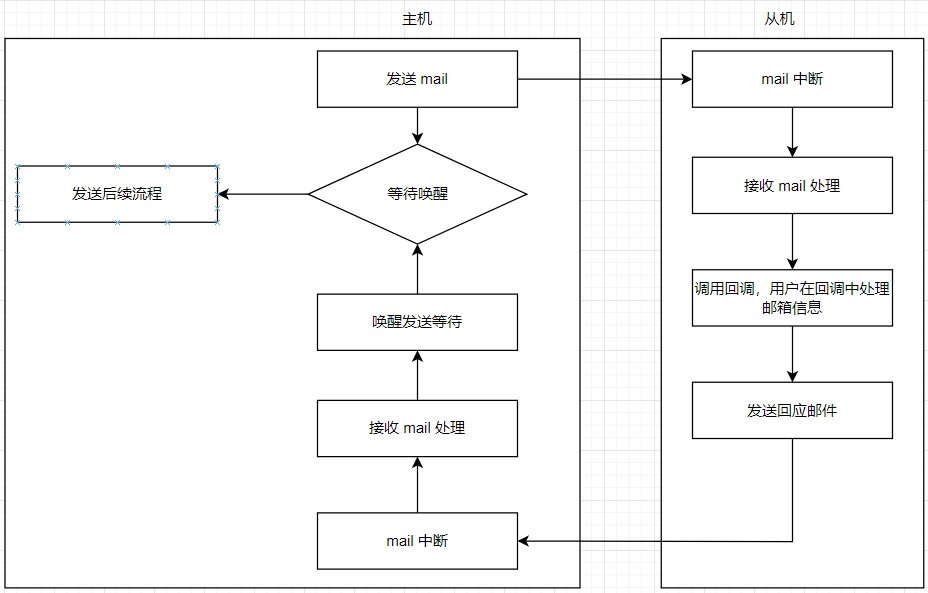
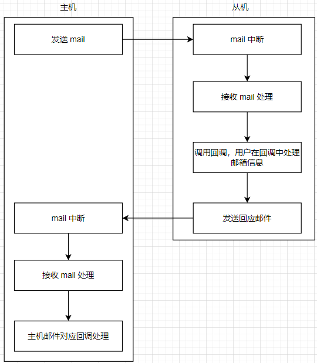

# T10x UAPI 用户手册

[TOC]

## 公共数据类型

### 概述

为了代码风格、数据类型一致，特定义公共数据类型。

### 数据类型

#### 通用数据类型定义

| 数据类型重定义    |   原型  |
| --- | --- |
| ts_u08 | unsigned char |
| ts_s08 | signed char |
| ts_u16 | unsigned short |
| ts_s16 | short |
| ts_u32 | unsigned int |
| ts_s32 | int |
| ts_u64 | unsigned long long |
| ts_s64 | long long |
| ts_ulong | unsigned long |
| ts_long | long |
| ts_char | char |
| ts_void | void |
| ts_f32 | float |
| ts_f64 | double |

#### 可变数据类型定义

为了节省内存，在一些 RTOS 平台，会将一些原本 64Bit 的数据类型，定义成 32Bit ，这些在不同

平台可能数据位宽不一致。定义如下：

```C
#ifdef __TDK_BW_64__
typedef long long           ts_loff_t;
typedef int                 ts_off_t;
typedef long long           ts_ssize_t;
typedef unsigned long long  ts_size_t;
typedef unsigned long long  ts_phys_addr_t;
typedef unsigned long long  ts_dma_addr_t;
#else
typedef int                 ts_loff_t;
typedef int                 ts_off_t;
typedef int                 ts_ssize_t;
typedef unsigned int        ts_size_t;
typedef unsigned int        ts_phys_addr_t;
typedef unsigned int        ts_dma_addr_t;
#endif
```

## 公共错误码

统一管理公共错误码，以及相应的错误信息输出，避免错误码混乱。

下表为摘要，完整内容请参考 `base/ts_errno.h` :

| 错误码    |   宏定义  |  错误信息输出 | 错误信息宏定义 |
| --- | --- | --- | --- |
| 1 | TS_EPERM | Operation not permitted | TS_EPERM_STR |
| 2 | TS_ENOENT | No such file or directory | TS_ENOENT_STR |
| 4 | TS_EINTR | Interrupted system call | TS_EINTR_STR |
| 5 | TS_EIO | I/O error | TS_EIO_STR |
| 6 | TS_ENXIO | No such device or address | TS_ENXIO_STR |

### 自定义错误码

#### 规则

| 31-24 Bit | 23-16 Bit | 15-8 Bit | 7-0 Bit |
| --- | --- | --- | --- |
| 魔术字(固定 0x5A ) | 日志等级 | 模块编码 | 错误码 |

模块编码于 IOCTL 编码共用，参考 `cpl/cpl_ioctl.h`

摘要如下：

```c
/* 统一管理模块魔术字 */

/* 基础模块 0x01 - 0x1F */
#define TS_IOC_MAGIC_UNKNOW     (0x00)
#define TS_IOC_MAGIC_SYS        (0x01)
#define TS_IOC_MAGIC_BASE       (0x02)
#define TS_IOC_MAGIC_LOG        (0x03)

/* 大型模块 0x20 - 0x4F */
#define TS_IOC_MAGIC_VI         (0x20)
#define TS_IOC_MAGIC_ISP        (0x21)
#define TS_IOC_MAGIC_VO         (0x22)
#define TS_IOC_MAGIC_OSD        (0x23)
#define TS_IOC_MAGIC_AF         (0x24)
```

## HWLock

### 概述

硬件实现，在读锁寄存器时，如果读到 1 则表明锁空闲，可占用，寄存器 1 状态在读的时候，自动被清零。

可用于双 CPU 之间互斥。

直接寄存器读写测试日志演示如下:

```shell
tdk #mem r 0x00160010 0x01

Address       Value(hex)      Value(dec)
[0x00160010]: 0x00000000      0

tdk #mem w 0x00160010 0x01
tdk #mem r 0x00160010 0x01

Address       Value(hex)      Value(dec)
[0x00160010]: 0x00000001      1

tdk #mem r 0x00160010 0x01

Address       Value(hex)      Value(dec)
[0x00160010]: 0x00000000      0
```

### API 说明

| 函数名 | 用途说明 |
| --- | --- |
| [ts_lib_hwlock_init](#ts_lib_hwlock_init) | 初始化 |
| [ts_lib_hwlock_deinit](#ts_lib_hwlock_deinit) | 去初始化 |
| [ts_lib_hwlock_get_free](#ts_lib_hwlock_get_free) | 申请一个空闲锁 |
| [ts_lib_hwlock_release](#ts_lib_hwlock_release) | 释放一个占用锁 |
| [ts_lib_hwlock_lock](#ts_lib_hwlock_lock) | 加锁 |
| [ts_lib_hwlock_unlock](#ts_lib_hwlock_unlock) | 解锁 |

#### ts_lib_hwlock_init

##### 描述

初始化,内部主要涉及到互斥锁的申请，无内存申请。

##### 语法

```c
ts_s32 ts_lib_hwlock_init(ts_u32 u32_regbase, ts_u32 u32_max_num)
```

##### 参数

| 参数名称 | 数据类型 | 描述 | 输入/输出 |
| --- | --- | --- | --- |
| u32_regbase | ts_u32 | 硬件锁寄存器基地址 | 输入 |
| u32_max_num | ts_u32 | 最多硬件锁个数 | 输入 |

##### 返回值

| 返回值 | 描述 |
| --- | --- |
| TS_ERR | 初始化失败 |
| TS_OK | 初始化成功 |

##### 版本差异

| 版本号 | 差异 |
| --- | --- |
| V100 | 支持此功能 |

##### 依赖

- 头文件 hwlock_v100.h

- 库文件 ts_otdk.a

##### 注意

无

##### 举例

```c
ts_void *pv_lock0;
ts_void *pv_lock1;
ts_void *pv_lock2;
ts_s32 s32_ret;

/* 初始化用户层硬件锁 */
ts_lib_hwlock_init(0x00160010, 4);

pv_lock0 = ts_lib_hwlock_get_free();
pv_lock1 = ts_lib_hwlock_get_free();
pv_lock2 = ts_lib_hwlock_get_free();

ts_lib_hwlock_release(pv_lock1);

s32_ret = ts_lib_hwlock_lock(pv_lock0);
if (TS_OK == s32_ret)
    ts_lib_hwlock_unlock(pv_lock0);

ts_lib_hwlock_deinit();
```

##### 相关主题

[ts_lib_hwlock_deinit](#ts_lib_hwlock_deinit)

#### ts_lib_hwlock_deinit

##### 描述

去初始化，内部无内存释放，只涉及到互斥锁销毁。

##### 语法

```c
ts_void ts_lib_hwlock_deinit(ts_void)
```

##### 参数

无

##### 返回值

无

##### 版本差异

| 版本号 | 差异 |
| --- | --- |
| V100 | 支持此功能 |

##### 依赖

- 头文件 hwlock_v100.h

- 库文件 ts_otdk.a

##### 注意

无

##### 举例

无

##### 相关主题

[ts_lib_hwlock_init](#ts_lib_hwlock_init)

#### ts_lib_hwlock_get_free

##### 描述

获取一个处于空闲的硬件锁句柄

##### 语法

```c
ts_void *ts_lib_hwlock_get_free(ts_void)
```

##### 参数

无

##### 返回值

| 返回值 | 描述 |
| --- | --- |
| ts_null | 申请失败，硬件锁都在使用中 |
| 非 ts_null | 硬件锁句柄 |

##### 版本差异

| 版本号 | 差异 |
| --- | --- |
| V100 | 支持此功能 |

##### 依赖

- 头文件 hwlock_v100.h

- 库文件 ts_otdk.a

##### 注意

无

##### 举例

无

##### 相关主题

[ts_lib_hwlock_init](#ts_lib_hwlock_init)

[ts_lib_hwlock_release](#ts_lib_hwlock_release)

#### ts_lib_hwlock_release

##### 描述

释放当前占用的硬件锁句柄，使之处于空闲状态

##### 语法

```c
ts_void ts_lib_hwlock_release(ts_void *pv_lock)
```

##### 参数

| 参数名称 | 数据类型 | 描述 | 输入/输出 |
| --- | --- | --- | --- |
| pv_lock | ts_void * | 硬件锁句柄 | 输入 |

##### 返回值

无

##### 版本差异

| 版本号 | 差异 |
| --- | --- |
| V100 | 支持此功能 |

##### 依赖

- 头文件 hwlock_v100.h

- 库文件 ts_otdk.a

##### 注意

无

##### 举例

无

##### 相关主题

[ts_lib_hwlock_init](#ts_lib_hwlock_init)

[ts_lib_hwlock_get_free](#ts_lib_hwlock_get_free)

#### ts_lib_hwlock_lock

##### 描述

尝试上锁。

##### 语法

```c
ts_s32 ts_lib_hwlock_lock(ts_void *pv_lock, ts_u32 u32_tmout_ms)
```

##### 参数

| 参数名称 | 数据类型 | 描述 | 输入/输出 |
| --- | --- | --- | --- |
| pv_lock | ts_void * | 硬件锁句柄 | 输入 |
| u32_tmout_ms | ts_u32 | 尝试上锁超时设定， 为 0 则阻塞 | 输入 |

##### 返回值

| 返回值 | 描述 |
| --- | --- |
| TS_OK | 上锁成功 |
| TS_ERR | 上锁失败 |

##### 版本差异

| 版本号 | 差异 |
| --- | --- |
| V100 | 支持此功能 |

##### 依赖

- 头文件 hwlock_v100.h

- 库文件 ts_otdk.a

##### 注意

无

##### 举例

无

##### 相关主题

[ts_lib_hwlock_init](#ts_lib_hwlock_init)

[ts_lib_hwlock_unlock](#ts_lib_hwlock_unlock)

#### ts_lib_hwlock_unlock

##### 描述

解锁

##### 语法

```c
ts_void ts_lib_hwlock_unlock(ts_void *pv_lock)
```

##### 参数

| 参数名称 | 数据类型 | 描述 | 输入/输出 |
| --- | --- | --- | --- |
| pv_lock | ts_void * | 硬件锁句柄 | 输入 |

##### 返回值

无

##### 版本差异

| 版本号 | 差异 |
| --- | --- |
| V100 | 支持此功能 |

##### 依赖

- 头文件 hwlock_v100.h

- 库文件 ts_otdk.a

##### 注意

无

##### 举例

无

##### 相关主题

[ts_lib_hwlock_init](#ts_lib_hwlock_init)

[ts_lib_hwlock_lock](#ts_lib_hwlock_lock)

### 数据类型

无

### 错误码

无

----

## I2C

### 概述

支持不同类型的 I2C 总线设备读写

### API 说明

| 函数名 | 用途说明 |
| --- | --- |
| [ts_lib_i2c_open](#ts_lib_i2c_open) | 打开 i2c 驱动设备 |
| [ts_lib_i2c_close](#ts_lib_i2c_close) | 关闭 i2c 驱动设备 |
| [ts_lib_i2c_ra08d08_read](#ts_lib_i2c_ra08d08_read) |  按照寄存器 8bit ， 数据 8bit 的格式读多个数据 |
| [ts_lib_i2c_ra08d08_readb](#ts_lib_i2c_ra08d08_readb) | 按照寄存器 8bit ， 数据 8bit 的格式读单个数据 |
| [ts_lib_i2c_ra08d08_write](#ts_lib_i2c_ra08d08_write) | 按照寄存器 8bit ， 数据 8bit 的格式写多个数据 |
| [ts_lib_i2c_ra08d08_writeb](#ts_lib_i2c_ra08d08_writeb) | 按照寄存器 8bit ， 数据 8bit 的格式写单个数据 |

#### ts_lib_i2c_open

##### 描述

打开指定的 i2c 驱动设备

##### 语法

```c
ts_s32 ts_lib_i2c_open(ts_char *pc_dev_name)
```

##### 参数

| 参数名称 | 数据类型  |  描述 |  输入/输出  |
| --- | --- | --- | --- |
| pc_dev_name | ts_char | 驱动设备文件名 | 输入 |

##### 返回值

| 返回值    |   描述  |
| --- | --- |
| < 0 | 设备打开失败 |
| >= 0 | 设备句柄 |

##### 版本差异

| 版本号    |   差异  |
| --- | --- |
| V100 | 支持此功能 |

##### 依赖

- 头文件 i2c_v100.h

- 库文件 ts_otdk.a

##### 注意

无

##### 举例

无

##### 相关主题

[ts_lib_i2c_close](#ts_lib_i2c_close)


#### ts_lib_i2c_close

##### 描述

关闭打开的 i2c 驱动设备句柄

##### 语法

```c
ts_void ts_lib_i2c_close(ts_s32 s32_handle)
```

##### 参数

| 参数名称    |   数据类型  |  描述     |  输入/输出  |
| --- | --- | --- | --- |
| s32_handle | ts_s32 | 驱动设备句柄 | 输入 |

##### 返回值

无

##### 版本差异

| 版本号    |   差异  |
| --- | --- |
| V100 | 支持此功能 |

##### 依赖

- 头文件 i2c_v100.h

- 库文件 ts_otdk.a

##### 注意

无

##### 举例

无

##### 相关主题

[ts_lib_i2c_open](#ts_lib_i2c_open)

#### ts_lib_i2c_ra08d08_read

##### 描述

按照指定的设备地址，寄存器，把指定长度的寄存器值读到缓冲中

##### 语法

```c
ts_s32 ts_lib_i2c_ra08d08_read(ts_s32 s32_handle, ts_u32 u32_dev_addr, ts_u32 u32_reg_addr, \
                ts_u08 *pu08_rd_buf, ts_u32 u32_cnt)
```

##### 参数

| 参数名称    |   数据类型  |  描述     |  输入/输出  |
| --- | --- | --- | --- |
| s32_handle | ts_s32 | 驱动设备句柄 | 输入 |
| u32_dev_addr | ts_u32 | i2c 总线上的设备器件地址 | 输入 |
| u32_reg_addr | ts_u32 | i2c 设备器件内的寄存器地址 | 输入 |
| pu08_rd_buf | ts_u08 * | 数据缓冲 | 输出 |
| u32_cnt | ts_u32 | 数据长度 | 输入 |

##### 返回值

| 返回值    |   描述  |
| --- | --- |
| TS_EINVAL | 无效参数 |
| TS_OK | 成功读取 |

##### 版本差异

| 版本号    |   差异  |
| --- | --- |
| V100 | 支持此功能 |

##### 依赖

- 头文件 i2c_v100.h

- 库文件 ts_otdk.a

##### 注意

无

##### 举例

无

##### 相关主题

[ts_lib_i2c_ra08d08_readb](#ts_lib_i2c_ra08d08_readb)

#### ts_lib_i2c_ra08d08_readb

##### 描述

按照指定的设备地址，寄存器，读取一个寄存器值

##### 语法

```c
ts_s32 ts_lib_i2c_ra08d08_readb(ts_s32 s32_handle, ts_u32 u32_dev_addr, ts_u32 u32_reg_addr, ts_u08 *u08_val)
```

##### 参数

| 参数名称    |   数据类型  |  描述     |  输入/输出  |
| --- | --- | --- | --- |
| s32_handle | ts_s32 | 驱动设备句柄 | 输入 |
| u32_dev_addr | ts_u32 | i2c 总线上的设备器件地址 | 输入 |
| u32_reg_addr | ts_u32 | i2c 设备器件内的寄存器地址 | 输入 |
| u08_val | ts_u08 * | 寄存器值 | 输出 |

##### 返回值

| 返回值    |   描述  |
| --- | --- |
| TS_EINVAL | 无效参数 |
| TS_OK | 成功读取 |

##### 版本差异

| 版本号    |   差异  |
| --- | --- |
| V100 | 支持此功能 |

##### 依赖

- 头文件 i2c_v100.h

- 库文件 ts_otdk.a

##### 注意

无

##### 举例

无

##### 相关主题

[ts_lib_i2c_ra08d08_read](#ts_lib_i2c_ra08d08_read)

#### ts_lib_i2c_ra08d08_write

##### 描述

按照指定的设备地址，寄存器，把指定长度的寄存器值缓冲写到 i2c 设备中去

##### 语法

```c
ts_s32 ts_lib_i2c_ra08d08_write(ts_s32 s32_handle, ts_u32 u32_dev_addr, ts_u32 u32_reg_addr, \
                ts_u08 *pu08_wr_buf, ts_u32 u32_cnt)
```

##### 参数

| 参数名称    |   数据类型  |  描述     |  输入/输出  |
| --- | --- | --- | --- |
| s32_handle | ts_s32 | 驱动设备句柄 | 输入 |
| u32_dev_addr | ts_u32 | i2c 总线上的设备器件地址 | 输入 |
| u32_reg_addr | ts_u32 | i2c 设备器件内的寄存器地址 | 输入 |
| pu08_wr_buf | ts_u08 * | 数据缓冲 | 输入 |
| u32_cnt | ts_u32 | 数据长度 | 输入 |

##### 返回值

| 返回值    |   描述  |
| --- | --- |
| TS_EINVAL | 无效参数 |
| TS_OK | 成功写入 |

##### 版本差异

| 版本号    |   差异  |
| --- | --- |
| V100 | 支持此功能 |

##### 依赖

- 头文件 i2c_v100.h

- 库文件 ts_otdk.a

##### 注意

无

##### 举例

无

##### 相关主题

[ts_lib_i2c_ra08d08_writeb](#ts_lib_i2c_ra08d08_writeb)

#### ts_lib_i2c_ra08d08_writeb

##### 描述

按照指定的设备地址，寄存器，把指单个寄存器值写到 i2c 设备中去

##### 语法

```c
ts_s32 ts_lib_i2c_ra08d08_writeb(ts_s32 s32_handle, ts_u32 u32_dev_addr, ts_u32 u32_reg_addr, ts_u08 u08_val)
```

##### 参数

| 参数名称    |   数据类型  |  描述     |  输入/输出  |
| --- | --- | --- | --- |
| s32_handle | ts_s32 | 驱动设备句柄 | 输入 |
| u32_dev_addr | ts_u32 | i2c 总线上的设备器件地址 | 输入 |
| u32_reg_addr | ts_u32 | i2c 设备器件内的寄存器地址 | 输入 |
| u08_val | ts_u08 | 寄存器值 | 输入 |

##### 返回值

| 返回值    |   描述  |
| --- | --- |
| TS_EINVAL | 无效参数 |
| TS_OK | 成功写入 |

##### 版本差异

| 版本号    |   差异  |
| --- | --- |
| V100 | 支持此功能 |

##### 依赖

- 头文件 i2c_v100.h

- 库文件 ts_otdk.a

##### 注意

无

##### 举例

无

##### 相关主题

[ts_lib_i2c_ra08d08_write](#ts_lib_i2c_ra08d08_write)

### 数据类型

#### ts_i2c_msg_s_t

##### 说明

i2c 读写的消息包，用于在 API 和 驱动层之间传递读写的 i2c 配置

##### 定义

```c
typedef struct ts_i2c_msg_s {
    ts_u08 u08_mode;
    ts_u08 au08_rev[3];
    ts_u16 u16_dev_addr;
    ts_u16 u16_reg_addr;
    ts_u32 u32_buf_size;
    ts_void *pv_buf;
    ts_i2c_attr_s_t *pst_attr;
} ts_i2c_msg_s_t;
```

##### 成员

| 成员名称 |   说明 |
| --- | --- |
| u08_mode | i2c 总线模式 |
| u16_dev_addr | 从设备器件地址 |
| u16_reg_addr | 从设备寄存器地址 |
| u32_buf_size | 本次传输的缓冲大小 |
| pv_buf | 本次传输的缓冲指针 |
| pst_attr | 本次传输指定的 i2c 驱动属性，如果为空，则使用默认的 i2c 驱动属性 |

- 总线模式定义

```C
#define I2C_BUS_RA08_D08        (0)
#define I2C_BUS_RA08_D16        (1)
#define I2C_BUS_RA16_D08        (2)
#define I2C_BUS_RA16_D16        (3)
```

| 定义名称 |   说明 |
| --- | --- |
| I2C_BUS_RA08_D08 | 寄存器地址位宽 8bit，数据位宽 8bit  |
| I2C_BUS_RA08_D16 | 寄存器地址位宽 8bit，数据位宽 16bit |
| I2C_BUS_RA16_D08 | 寄存器地址位宽 16bit，数据位宽 8bit |
| I2C_BUS_RA16_D16 | 寄存器地址位宽 16bit，数据位宽 16bit |

##### 注意

无

##### 相关数据类型与接口

[ts_i2c_attr_s_t](#ts_i2c_attr_s_t)

#### ts_i2c_attr_s_t

##### 说明

i2c 驱动属性定义

##### 定义

```c
typedef struct ts_i2c_attr_s {
    ts_u08 u08_master;
    ts_u08 u08_duty;
    ts_u08 u08_duty_adj;
    ts_u08 u08_roll_thr;
    ts_u08 u08_sda_hold_us;
    ts_u08 u08_sda_hold_clk;
    ts_u08 u08_sda_setup_us;
    ts_u08 u08_time_out_jfs;
    ts_u32 u32_bus_hz;
} ts_i2c_attr_s_t;
```

##### 成员

| 成员名称 |   说明 |
| --- | --- |
| u08_master | i2c 总线主从模式配置 |
| u08_duty | i2c 总线时钟的占空比设置，配置范围 10..90 |
| u08_duty_adj | i2c 总线时钟的占空比微调配置 |
| u08_roll_thr | 在传输大小大于 u08_roll_thr 时，将开启中断传输模式 |
| u08_sda_hold_us | SDA 后于 SCL 输出的延迟时间配置 |
| u08_sda_hold_clk | SDA 后于 SCL 输出的延迟时钟配置 |
| u08_time_out_jfs | 传输超时配置, 最小一个系统滴答 |
| u32_bus_hz | i2c 总线时钟配置 |

- u08_duty_adj

调整时钟占空比，默认时钟为 50% , 比如根据 u32_bus_hz 计算出来，高时钟计数 50， 

低时钟计数 50, 如 u16_duty_adj 不为 0 ， 则 高时钟 += u16_duty_adj， 低时钟 -= u16_duty_adj

- u08_sda_hold_us and u08_sda_hold_clk

配置 SDA HOLD，单位微妙， 数据将在 SCL 下降延后延迟配置微妙时间后输出, 配置成 0 则使用 u08_sda_hold_clk

配置 SDA HOLD，单位 hz， 数据将在 SCL 下降延后延迟配置 hz 数后输出(非 SCL 时钟，一般为 i2c 模块的 APB 时钟)

配置成 0 成使用 u08_sda_hold_us , 则 u08_sda_hold_clk 优先于 u08_sda_hold_us

##### 注意

无

##### 相关数据类型与接口

无

### 错误码

无

----

## SFC

参见 `T10x软件用户手册_sffs.pdf`

----

## DMA

### 概述

### API 说明

| 函数名 | 用途说明 |
| --- | --- |
| [ts_lib_dma_open](#ts_lib_dma_open) | 打开 dma 设备 |
| [ts_lib_dma_close](#ts_lib_dma_close) | 关闭 dma 设备 |
| [ts_lib_dma_memcpy](#ts_lib_dma_memcpy) | dma 实现的 memcpy 功能, 按照 32bit 拷贝 |
| [ts_lib_dma_memcpy64](#ts_lib_dma_memcpy64) | dma 实现的 memcpy 功能, 按照 64bit 拷贝 |
| [ts_lib_dma_memcpy16](#ts_lib_dma_memcpy16) | dma 实现的 memcpy 功能, 按照 16bit 拷贝 |
| [ts_lib_dma_memcpy8](#ts_lib_dma_memcpy8) | dma 实现的 memcpy 功能, 按照 8bit 拷贝 |

#### ts_lib_dma_open

##### 描述

打开 DMA 设备

##### 语法

```c
ts_s32 ts_lib_dma_open(ts_char *pc_dev_name)
```

##### 参数

| 参数名称 | 数据类型 | 描述 | 输入/输出 |
| --- | --- | --- | --- |
| pc_dev_name | ts_char * | dma 设备名 | 输入 |

##### 返回值

| 返回值 | 描述 |
| --- | --- |
| TS_OK | 打开成功 |
| TS_ERR | 打开失败 |

##### 版本差异

| 版本号 | 差异 |
| --- | --- |
| V100 | 支持此功能 |

##### 依赖

- 头文件 dmac_v100.h

- 库文件 ts_otdk.a

##### 注意

- 使用 dma 模块之前，需要打开 dma 的时钟和复位

##### 举例

```c
insmod("dmac", ts_null);

ts_lib_dma_open("/dev/tdk/dmac");

ts_lib_dma_memcpy((ts_void *)pu32_dst_ptr, (const ts_void *)pu32_src_ptr, u32_size);

ts_lib_dma_close();

```

##### 相关主题

[ts_lib_dma_close](#ts_lib_dma_close)

#### ts_lib_dma_close

##### 描述

关闭 DMA 设备

##### 语法

```c
ts_void ts_lib_dma_close(ts_void)
```

##### 参数

无

##### 返回值

无

##### 版本差异

| 版本号 | 差异 |
| --- | --- |
| V100 | 支持此功能 |

##### 依赖

- 头文件 dmac_v100.h

- 库文件 ts_otdk.a

##### 注意

无

##### 举例

无

##### 相关主题

[ts_lib_dma_open](#ts_lib_dma_open)

#### ts_lib_dma_memcpy

##### 描述

dma 按照 32 bit 为单位进行传输

##### 语法

```c
ts_void *ts_lib_dma_memcpy(ts_void *pv_dst, const ts_void *pv_src, ts_u32 u32_count)
```

##### 参数

| 参数名称 | 数据类型 | 描述 | 输入/输出 |
| --- | --- | --- | --- |
| pv_dst | ts_void * | 目标地址 | 输出 |
| pv_src | ts_void * | 源地址 | 输入 |
| u32_count | ts_u32 | 拷贝个数， byte 为单位 | 输入 |

##### 返回值

| 返回值 | 描述 |
| --- | --- |
| ts_null | 拷贝失败 |
| pv_dst | 拷贝成功 |

##### 版本差异

| 版本号 | 差异 |
| --- | --- |
| V100 | 支持此功能 |

##### 依赖

- 头文件 dmac_v100.h

- 库文件 ts_otdk.a

##### 注意

无

##### 举例

无

##### 相关主题

[ts_lib_dma_memcpy64](#ts_lib_dma_memcpy64)
[ts_lib_dma_memcpy16](#ts_lib_dma_memcpy16)
[ts_lib_dma_memcpy8](#ts_lib_dma_memcpy8)

#### ts_lib_dma_memcpy64

##### 描述

dma 按照 64 bit 为单位进行传输

##### 语法

```c
ts_void *ts_lib_dma_memcpy64(ts_void *pv_dst, const ts_void *pv_src, ts_u32 u32_count)
```

##### 参数

| 参数名称 | 数据类型 | 描述 | 输入/输出 |
| --- | --- | --- | --- |
| pv_dst | ts_void * | 目标地址 | 输出 |
| pv_src | ts_void * | 源地址 | 输入 |
| u32_count | ts_u32 | 拷贝个数， byte 为单位 | 输入 |

##### 返回值

| 返回值 | 描述 |
| --- | --- |
| ts_null | 拷贝失败 |
| pv_dst | 拷贝成功 |

##### 版本差异

| 版本号 | 差异 |
| --- | --- |
| V100 | 支持此功能 |

##### 依赖

- 头文件 dmac_v100.h

- 库文件 ts_otdk.a

##### 注意

无

##### 举例

无

##### 相关主题

[ts_lib_dma_memcpy](#ts_lib_dma_memcpy)
[ts_lib_dma_memcpy16](#ts_lib_dma_memcpy16)
[ts_lib_dma_memcpy8](#ts_lib_dma_memcpy8)

#### ts_lib_dma_memcpy16

##### 描述

dma 按照 16 bit 为单位进行传输

##### 语法

```c
ts_void *ts_lib_dma_memcpy16(ts_void *pv_dst, const ts_void *pv_src, ts_u32 u32_count)
```

##### 参数

| 参数名称 | 数据类型 | 描述 | 输入/输出 |
| --- | --- | --- | --- |
| pv_dst | ts_void * | 目标地址 | 输出 |
| pv_src | ts_void * | 源地址 | 输入 |
| u32_count | ts_u32 | 拷贝个数， byte 为单位 | 输入 |

##### 返回值

| 返回值 | 描述 |
| --- | --- |
| ts_null | 拷贝失败 |
| pv_dst | 拷贝成功 |

##### 版本差异

| 版本号 | 差异 |
| --- | --- |
| V100 | 支持此功能 |

##### 依赖

- 头文件 dmac_v100.h

- 库文件 ts_otdk.a

##### 注意

无

##### 举例

无

##### 相关主题

[ts_lib_dma_memcpy](#ts_lib_dma_memcpy)
[ts_lib_dma_memcpy64](#ts_lib_dma_memcpy64)
[ts_lib_dma_memcpy8](#ts_lib_dma_memcpy8)


#### ts_lib_dma_memcpy8

##### 描述

dma 按照 8 bit 为单位进行传输

##### 语法

```c
ts_void *ts_lib_dma_memcpy8(ts_void *pv_dst, const ts_void *pv_src, ts_u32 u32_count)
```

##### 参数

| 参数名称 | 数据类型 | 描述 | 输入/输出 |
| --- | --- | --- | --- |
| pv_dst | ts_void * | 目标地址 | 输出 |
| pv_src | ts_void * | 源地址 | 输入 |
| u32_count | ts_u32 | 拷贝个数， byte 为单位 | 输入 |

##### 返回值

| 返回值 | 描述 |
| --- | --- |
| ts_null | 拷贝失败 |
| pv_dst | 拷贝成功 |

##### 版本差异

| 版本号 | 差异 |
| --- | --- |
| V100 | 支持此功能 |

##### 依赖

- 头文件 dmac_v100.h

- 库文件 ts_otdk.a

##### 注意

无

##### 举例

无

##### 相关主题

[ts_lib_dma_memcpy](#ts_lib_dma_memcpy)
[ts_lib_dma_memcpy64](#ts_lib_dma_memcpy64)
[ts_lib_dma_memcpy16](#ts_lib_dma_memcpy16)

### 数据类型

无

### 错误类型

无

## MBOX

### 概述

mbox 为异构双 CPU 之间通讯模块，实现双 CPU 协同工作。

mbox 支持同步和异步通讯模式：

#### 同步

同步模式，也称之为执行同步信号邮箱。

在发送邮件后，函数会阻塞在发送函数中，只有从从机接收到正确的回应邮件后才会被唤醒，重新执行

>

#### 异步

异步模式，也称之为执行回调函数邮箱。

在发送邮件后，函数会立即返回，不会等待后续接收。

>


### API 说明

| 函数名 | 用途说明 |
| --- | --- |
| [ts_lib_mbox_open](#ts_lib_mbox_open) | 打开邮箱设备 |
| [ts_lib_mbox_close](#ts_lib_mbox_close) | 关闭邮箱设备 |
| [ts_lib_mbox_set_live_attr](#ts_lib_mbox_set_live_attr) | 设置心跳属性 |
| [ts_lib_mbox_ack_live](#ts_lib_mbox_ack_live) | 用于从片发送心跳应答包 |
| [ts_lib_mbox_query_live](#ts_lib_mbox_query_live) | 用于主片发送心跳查询包 |
| [ts_lib_mbox_create_cb](#ts_lib_mbox_create_cb) | 创建一个基于执行回调函数的邮箱 |
| [ts_lib_mbox_create_sem](#ts_lib_mbox_create_sem) | dma 实现的 memcpy 功能, 按照 8bit 拷贝 |
| [ts_lib_mbox_new_mail](#ts_lib_mbox_new_mail) | dma 实现的 memcpy 功能, 按照 8bit 拷贝 |
| [ts_lib_mbox_modify_mail](#ts_lib_mbox_modify_mail) | dma 实现的 memcpy 功能, 按照 8bit 拷贝 |
| [ts_lib_mbox_free_mail](#ts_lib_mbox_free_mail) | dma 实现的 memcpy 功能, 按照 8bit 拷贝 |
| [ts_lib_mbox_send_mail](#ts_lib_mbox_send_mail) | dma 实现的 memcpy 功能, 按照 8bit 拷贝 |

#### ts_lib_mbox_open

##### 描述

打开邮箱设备

##### 语法

```c
ts_s32 ts_lib_mbox_open(ts_char *pc_dev_name)
```

##### 参数

| 参数名称 | 数据类型 | 描述 | 输入/输出 |
| --- | --- | --- | --- |
| pc_dev_name | ts_char * | 邮箱设备名 | 输入 |

##### 返回值

| 返回值 | 描述 |
| --- | --- |
|  > 0 | 邮箱句柄 |
| <= 0 | 打开邮箱设备失败 |

##### 版本差异

| 版本号 | 差异 |
| --- | --- |
| V100 | 支持此功能 |

##### 依赖

- 头文件 mbox_v100.h

- 库文件 ts_otdk.a

##### 注意

无

##### 举例

主机端：

```c
static ts_s32 ss32_mbox_hdl;
static ts_u32 su32_alive;

static ts_void mbox_live_ack(ts_void *pv_prive, ts_u32 u32_live_cnt)
{
    su32_alive = u32_live_cnt;
}

ts_void run_mbox(ts_void)
{
    ts_u32 u32_live_now;

    /* 已主模式方式加载邮箱驱动 */
    insmod("mbox", "su32_slave=0 su32_mail_num=64 su32_mail_buf=0x0223f000");

    ss32_mbox_hdl = ts_lib_mbox_open("/dev/tdk/mbox");

    /* 设置邮箱心跳应答 */
    ts_lib_mbox_set_live_attr(ss32_mbox_hdl, mbox_live_ack);

    u32_live_now = 0;
    su32_alive = 0;
    while (1) {
        ts_cpl_msleep(5000);

        /* 查询心跳一次 */
        if (su32_alive != u32_live_now)
            printf("die(alive,now) = %d , %d\n", su32_alive, u32_live_now);

        u32_live_now = ts_lib_mbox_query_live(ss32_mbox_hdl, u32_live_now);
    }

    ts_lib_mbox_close(ss32_mbox_hdl);
}
```

从机端：

```c
static ts_s32 ss32_mbox_hdl;

static ts_void mbox_live_query(ts_void *pv_prive, ts_u32 u32_live_cnt)
{
    ts_lib_mbox_ack_live(ss32_mbox_hdl, u32_live_cnt);
}

ts_void run_mbox(ts_void)
{

    /* 已从模式方式加载邮箱驱动 */
    insmod("mbox", "su32_slave=1 su32_mail_num=64 su32_mail_buf=0x0223f000");

    ss32_mbox_hdl = ts_lib_mbox_open("/dev/tdk/mbox");

    /* 设置邮箱心跳应答 */
    ts_lib_mbox_set_live_attr(ss32_mbox_hdl, mbox_live_query);

    while(1) {
        ts_cpl_msleep(5000);
    }

    ts_lib_mbox_close(ss32_mbox_hdl);
}
```

##### 相关主题

[ts_lib_mbox_close](#ts_lib_mbox_close)


#### ts_lib_mbox_close

##### 描述

关闭邮箱设备

##### 语法

```c
ts_void ts_lib_mbox_close(ts_s32 s32_handle)
```

##### 参数

| 参数名称 | 数据类型 | 描述 | 输入/输出 |
| --- | --- | --- | --- |
| s32_handle | ts_s32 | 邮箱句柄 | 输入 |

##### 返回值

无

##### 版本差异

| 版本号 | 差异 |
| --- | --- |
| V100 | 支持此功能 |

##### 依赖

- 头文件 mbox_v100.h

- 库文件 ts_otdk.a

##### 注意

无

##### 举例

无


##### 相关主题

[ts_lib_mbox_open](#ts_lib_mbox_open)


#### ts_lib_mbox_set_live_attr

##### 描述

设置心跳回调函数,主机端设置的为心跳应答接收，从机端设置的为心跳应答发送。

##### 语法

```c
ts_void ts_lib_mbox_set_live_attr(ts_s32 s32_handle, ts_mbox_cb_t pfn_cb)
```

##### 参数

| 参数名称 | 数据类型 | 描述 | 输入/输出 |
| --- | --- | --- | --- |
| s32_handle | ts_s32 | 邮箱句柄 | 输入 |
| pfn_cb | ts_mbox_cb_t | 应答回调函数 | 输入 |

##### 返回值

无

##### 版本差异

| 版本号 | 差异 |
| --- | --- |
| V100 | 支持此功能 |

##### 依赖

- 头文件 mbox_v100.h

- 库文件 ts_otdk.a

##### 注意

无

##### 举例

无


##### 相关主题

[ts_lib_mbox_ack_live](#ts_lib_mbox_ack_live)

[ts_lib_mbox_query_live](#ts_lib_mbox_query_live)


#### ts_lib_mbox_ack_live

##### 描述

从机发送心跳应答包

##### 语法

```c
ts_void ts_lib_mbox_ack_live(ts_s32 s32_handle, ts_u32 u32_live_cnt)
```

##### 参数

| 参数名称 | 数据类型 | 描述 | 输入/输出 |
| --- | --- | --- | --- |
| s32_handle | ts_s32 | 邮箱句柄 | 输入 |
| u32_live_cnt | ts_u32 | 当前从主机接收到的心跳计数 | 输入 |

##### 返回值

无

##### 版本差异

| 版本号 | 差异 |
| --- | --- |
| V100 | 支持此功能 |

##### 依赖

- 头文件 mbox_v100.h

- 库文件 ts_otdk.a

##### 注意

无

##### 举例

无


##### 相关主题

[ts_lib_mbox_set_live_attr](#ts_lib_mbox_set_live_attr)

[ts_lib_mbox_query_live](#ts_lib_mbox_query_live)

#### ts_lib_mbox_query_live

##### 描述

主机发送心跳查询包

##### 语法

```c
ts_u32 ts_lib_mbox_query_live(ts_s32 s32_handle, ts_u32 u32_live_cnt)
```

##### 参数

| 参数名称 | 数据类型 | 描述 | 输入/输出 |
| --- | --- | --- | --- |
| s32_handle | ts_s32 | 邮箱句柄 | 输入 |
| u32_live_cnt | ts_u32 | 主机当前心跳计数 | 输入 |

##### 返回值

| 返回值 | 描述 |
| --- | --- |
| 0..3FFFFFFF | 下一个心跳计数 |

##### 版本差异

| 版本号 | 差异 |
| --- | --- |
| V100 | 支持此功能 |

##### 依赖

- 头文件 mbox_v100.h

- 库文件 ts_otdk.a

##### 注意

无

##### 举例

无


##### 相关主题

[ts_lib_mbox_set_live_attr](#ts_lib_mbox_set_live_attr)

[ts_lib_mbox_ack_live](#ts_lib_mbox_ack_live)


#### ts_lib_mbox_create_cb

##### 描述

创建一个基于执行回调函数的邮箱,即异步邮箱

##### 语法

```c
ts_s32 ts_lib_mbox_create_cb(ts_s32 s32_handle, ts_u32 u32_id, ts_mbox_cb_t pfn_cb, ts_void *pv_priv)
```

##### 参数

| 参数名称 | 数据类型 | 描述 | 输入/输出 |
| --- | --- | --- | --- |
| s32_handle | ts_s32 | 邮箱句柄 | 输入 |
| u32_id | ts_u32 | 邮箱 ID | 输入 |
| pfn_cb | ts_mbox_cb_t | 邮箱回调处理函数 | 输入 |
| pv_priv | ts_void * | 回调函数私有变量 | 输入 |

##### 返回值

| 返回值 | 描述 |
| --- | --- |
| TS_OK | 创建成功 |
| TS_ENODEV | 传入句柄属于无效设备 |
| TS_ENOMEM | 分配内存失败 |

##### 版本差异

| 版本号 | 差异 |
| --- | --- |
| V100 | 支持此功能 |

##### 依赖

- 头文件 mbox_v100.h

- 库文件 ts_otdk.a

##### 注意

无

##### 举例

mbox_def.h:

```c
#ifndef __MBOX_DEF_H__
#define __MBOX_DEF_H__

/* 普通参数传递示例邮箱 */
#define MBOX_DEMO_ID_HOST_PARAM         TS_MBOX_GEN_ID(0, 4)
#define MBOX_DEMO_ID_SLAVE_PARAM        TS_MBOX_GEN_ID(0, 5)

/* 使用邮箱实现类远程调用函数 */
#define MBOX_DEMO_ID_HOST_RPC           TS_MBOX_GEN_ID(1, 6)
#define MBOX_DEMO_ID_SLAVE_RPC          TS_MBOX_GEN_ID(1, 7)

/* 使用邮箱实现异步计算功能 */
#define MBOX_DEMO_ID_HOST_ASYNC         TS_MBOX_GEN_ID(2, 8)
#define MBOX_DEMO_ID_SLAVE_ASYNC        TS_MBOX_GEN_ID(2, 9)

typedef struct mbox_rpc_add_ctx_s {
    /* 保存邮件正文缓冲指针 */
    ts_u32 *pu32_rpc;

    /* rpc 信号量 */
    ts_cpl_semphr_s_t st_rpc_sema;

    /* 邮箱设备句柄 */
    ts_s32 s32_hdl;
} mbox_rpc_add_ctx_s_t;

#endif /* __MBOX_DEF_H__ */
```

主机端：

```c
static ts_s32 ss32_mbox_hdl;

/* 简单内存分配 */
#define MBOX_ASYNC_BUF0         (0x0223e000)
#define MBOX_ASYNC_BUF1         (0x0223e400)
#define MBOX_ASYNC_BUF2         (0x0223e800)
#define MBOX_ASYNC_BUF3         (0x0223eC00)
#define MBOX_ASYNC_BUF_SIZE     (0x400)

static ts_s32 mbox_host_async_send(ts_s32 s32_hdl, ts_u32 *pu32_ptr, ts_u32 u32_size, ts_u32 u32_sum)
{
    ts_u32 *pu32_content;

    pu32_content = ts_lib_mbox_new_mail(ss32_mbox_hdl, MBOX_DEMO_ID_HOST_ASYNC, MBOX_DEMO_ID_SLAVE_ASYNC);
    if (pu32_content != ts_null) {
        pu32_content[0] = (ts_u32)pu32_ptr;
        pu32_content[1] = u32_size;
        pu32_content[2] = u32_sum;

        ts_lib_mbox_send_mail(s32_hdl, (ts_u32)pu32_content);

        return TS_OK;
    } else {
        return TS_ERR;
    }
}


static ts_void mbox_host_async_cb(ts_void *pv_prive, ts_u32 u32_param)
{
    ts_u32 *pu32_content;
    ts_u32 u32_sum;

    /* 返回的还是主机使用的 mail */
    pu32_content = (ts_u32 *)u32_param;
    u32_sum = pu32_content[0];

    printf("async calc= %#x, rd= %#x, free= %#x\n", pu32_content[2], u32_sum, (ts_u32)pu32_content);

    /* 释放邮件 */
    ts_lib_mbox_free_mail(pu32_content);
}

static ts_void mbox_host_async_test(ts_s32 s32_hdl, ts_u32 u32_buf_addr, ts_u32 u32_size)
{
    ts_u32 *pu32_ptr;
    ts_u32 i, u32_tmp, u32_sum;

    pu32_ptr = (ts_u32 *)u32_buf_addr;
    u32_sum = 0;
    for (i = 0; i < (u32_size >> 2); i++) {
        u32_tmp = ts_cpl_random();
        *pu32_ptr++ = u32_tmp;
        u32_sum += u32_tmp;
    }

    /* 同步数据到内存,如果使用 DMA 内存，则无需 flush cache */
    ts_cpl_sync_dma_for_device(ts_null, u32_buf_addr, u32_size);

    mbox_host_async_send(s32_hdl, (ts_u32 *)u32_buf_addr, u32_size, u32_sum);
}

ts_void run_mbox(ts_void)
{
    ts_u32 *pu32_ptr;

    /* 使用者自定义邮箱上下文 */
    mbox_rpc_add_ctx_s_t st_rpc_add;

    /* 已主模式方式加载邮箱驱动 */
    insmod("mbox", "su32_slave=0 su32_mail_num=64 su32_mail_buf=0x0223f000");

    ss32_mbox_hdl = ts_lib_mbox_open("/dev/tdk/mbox");

    /* 异步演示申请 mail 空间 */
    ts_lib_mbox_create_cb(ss32_mbox_hdl, MBOX_DEMO_ID_HOST_ASYNC, mbox_host_async_cb, ts_null);

    /* 配置随机种子 */
    ts_cpl_srand(0x11223344);

    while (1) {
        ts_cpl_msleep(5000);

        /* 演示同时发送多个邮件至从机 */
        mbox_host_async_test(ss32_mbox_hdl, MBOX_ASYNC_BUF0, MBOX_ASYNC_BUF_SIZE);
        mbox_host_async_test(ss32_mbox_hdl, MBOX_ASYNC_BUF1, MBOX_ASYNC_BUF_SIZE);
        mbox_host_async_test(ss32_mbox_hdl, MBOX_ASYNC_BUF2, MBOX_ASYNC_BUF_SIZE);
        mbox_host_async_test(ss32_mbox_hdl, MBOX_ASYNC_BUF3, MBOX_ASYNC_BUF_SIZE);
    }

    ts_lib_mbox_close(ss32_mbox_hdl);
}
```

从机端：

```c
static ts_s32 ss32_mbox_hdl;

static ts_void mbox_slave_async_cb(ts_void *pv_prive, ts_u32 u32_param)
{
    ts_u32 *pu32_ptr;
    ts_u32 i, u32_addr, u32_size, u32_sum;
    ts_u32 *pu32_content;

    /* 发送邮件正文，有共享内存，需要进行 cache 操作（如 DMA 内存则无需 invalid 操作） */
    pu32_ptr = (ts_u32 *)u32_param;
    u32_addr = pu32_ptr[0];
    u32_size = pu32_ptr[1];

    ts_cpl_sync_dma_for_cpu(ts_null, (ts_phys_addr_t)u32_addr, u32_size);

    /* 计算 */
    u32_sum = 0;
    pu32_ptr = (ts_u32 *)u32_addr;
    for (i = 0; i < (u32_size >> 2); i++)
        u32_sum += *pu32_ptr++;

    /* 返回结果 */
    pu32_content = (ts_u32 *)u32_param;
    pu32_content[0] = u32_sum;

    ts_lib_mbox_modify_mail(pu32_content, MBOX_DEMO_ID_SLAVE_ASYNC, MBOX_DEMO_ID_HOST_ASYNC);

    ts_lib_mbox_send_mail(ss32_mbox_hdl, (ts_u32)pu32_content);
}

ts_void run_mbox(ts_void)
{
    /* 已从模式方式加载邮箱驱动 */
    insmod("mbox", "su32_slave=1 su32_mail_num=64 su32_mail_buf=0x0223f000");

    ss32_mbox_hdl = ts_lib_mbox_open("/dev/tdk/mbox");

    /* 申请 MBOX_DEMO_ID_SLAVE_ASYNC 邮箱, 从核只会依次处理，并使用主机 mail 返回 */
    ts_lib_mbox_new_mail(ss32_mbox_hdl, MBOX_DEMO_ID_SLAVE_ASYNC, MBOX_DEMO_ID_HOST_ASYNC);
    ts_lib_mbox_create_cb(ss32_mbox_hdl, MBOX_DEMO_ID_SLAVE_ASYNC, mbox_slave_async_cb, ts_null);
    while(1) {
        ts_cpl_msleep(5000);
    }

    ts_lib_mbox_close(ss32_mbox_hdl);
}
```


##### 相关主题

[ts_lib_mbox_create_sem](#ts_lib_mbox_create_sem)

[ts_lib_mbox_new_mail](#ts_lib_mbox_new_mail)


#### ts_lib_mbox_create_sem

##### 描述

创建一个基于执行同步信号的邮箱,即同步邮箱

##### 语法

```c
ts_s32 ts_lib_mbox_create_sem(ts_s32 s32_handle, ts_u32 u32_id, ts_cpl_semphr_s_t *pst_sema)
```

##### 参数

| 参数名称 | 数据类型 | 描述 | 输入/输出 |
| --- | --- | --- | --- |
| s32_handle | ts_s32 | 邮箱句柄 | 输入 |
| u32_id | ts_u32 | 邮箱 ID | 输入 |
| pst_sema | ts_cpl_semphr_s_t * | 用户申请的信号量 | 输入 |

##### 返回值

| 返回值 | 描述 |
| --- | --- |
| TS_OK | 创建成功 |
| TS_ENODEV | 传入句柄属于无效设备 |
| TS_ENOMEM | 分配内存失败 |

##### 版本差异

| 版本号 | 差异 |
| --- | --- |
| V100 | 支持此功能 |

##### 依赖

- 头文件 mbox_v100.h

- 库文件 ts_otdk.a

##### 注意

无

##### 举例

mbox_def.h:

```c
#ifndef __MBOX_DEF_H__
#define __MBOX_DEF_H__

/* 普通参数传递示例邮箱 */
#define MBOX_DEMO_ID_HOST_PARAM         TS_MBOX_GEN_ID(0, 4)
#define MBOX_DEMO_ID_SLAVE_PARAM        TS_MBOX_GEN_ID(0, 5)

/* 使用邮箱实现类远程调用函数 */
#define MBOX_DEMO_ID_HOST_RPC           TS_MBOX_GEN_ID(1, 6)
#define MBOX_DEMO_ID_SLAVE_RPC          TS_MBOX_GEN_ID(1, 7)

/* 使用邮箱实现异步计算功能 */
#define MBOX_DEMO_ID_HOST_ASYNC         TS_MBOX_GEN_ID(2, 8)
#define MBOX_DEMO_ID_SLAVE_ASYNC        TS_MBOX_GEN_ID(2, 9)

typedef struct mbox_rpc_add_ctx_s {
    /* 保存邮件正文缓冲指针 */
    ts_u32 *pu32_rpc;

    /* rpc 信号量 */
    ts_cpl_semphr_s_t st_rpc_sema;

    /* 邮箱设备句柄 */
    ts_s32 s32_hdl;
} mbox_rpc_add_ctx_s_t;

#endif /* __MBOX_DEF_H__ */
```

主机端：

```c
static ts_s32 ss32_mbox_hdl;

static ts_u32 mbox_host_rpc_add_call(mbox_rpc_add_ctx_s_t *pst_add_ctx, ts_u32 u32_val0, ts_u32 u32_val1)
{
    ts_cpl_semphr_s_t *pst_sema;

    pst_sema = &pst_add_ctx->st_rpc_sema;

    pst_add_ctx->pu32_rpc[0] = u32_val0;
    pst_add_ctx->pu32_rpc[1] = u32_val1;

    ts_lib_mbox_modify_mail(pst_add_ctx->pu32_rpc, MBOX_DEMO_ID_HOST_RPC, MBOX_DEMO_ID_SLAVE_RPC);
    ts_lib_mbox_send_mail(pst_add_ctx->s32_hdl, (ts_u32)pst_add_ctx->pu32_rpc);
    ts_cpl_down(pst_sema);

    return pst_add_ctx->pu32_rpc[0];
}

ts_void run_mbox(ts_void)
{
    ts_u32 u32_sum, u32_val0, u32_val1;

    /* 使用者自定义邮箱上下文 */
    mbox_rpc_add_ctx_s_t st_rpc_add;

    /* 已主模式方式加载邮箱驱动 */
    insmod("mbox", "su32_slave=0 su32_mail_num=64 su32_mail_buf=0x0223f000");

    ss32_mbox_hdl = ts_lib_mbox_open("/dev/tdk/mbox");

    /* 使用同步信号的只需要主机方申请 mail 空间 */
    st_rpc_add.pu32_rpc = ts_lib_mbox_new_mail(ss32_mbox_hdl, MBOX_DEMO_ID_HOST_RPC, MBOX_DEMO_ID_SLAVE_RPC);
    if (st_rpc_add.pu32_rpc != ts_null) {
        ts_cpl_semphr_init((ts_cpl_semphr_s_t *)&st_rpc_add.st_rpc_sema, 0);
        ts_lib_mbox_create_sem(ss32_mbox_hdl, MBOX_DEMO_ID_HOST_RPC, (ts_cpl_semphr_s_t *)&st_rpc_add.st_rpc_sema);

        st_rpc_add.s32_hdl = ss32_mbox_hdl;
    }

    while (1) {
        ts_cpl_msleep(5000);

        u32_sum = mbox_host_rpc_add_call(&st_rpc_add, u32_val0, u32_val1);
        printf("==>ret_sum = %#x, calc_sum=%#x\n", u32_sum, (u32_val0 + u32_val1));
    }

    ts_lib_mbox_close(ss32_mbox_hdl);
}
```

从机端：

```c
static ts_s32 ss32_mbox_hdl;

static ts_void mbox_slave_rpc_add(ts_void *pv_prive, ts_u32 u32_param)
{
    ts_u32 *pu32_ptr;
    ts_u32 u32_sum;

    pu32_ptr = (ts_u32 *)u32_param;
    u32_sum = pu32_ptr[0] + pu32_ptr[1];

    printf("calc_sum = %#x, v0=%#x,v1=%#x\n", u32_sum, pu32_ptr[0], pu32_ptr[1]);

    pu32_ptr[0] = u32_sum;

    /* 使用主机的缓冲， 直接修改主机邮件发回 */
    ts_lib_mbox_modify_mail(pu32_ptr, MBOX_DEMO_ID_SLAVE_RPC, MBOX_DEMO_ID_HOST_RPC);

    ts_lib_mbox_send_mail(ss32_mbox_hdl, u32_param);
}

ts_void run_mbox(ts_void)
{
    /* 已从模式方式加载邮箱驱动 */
    insmod("mbox", "su32_slave=1 su32_mail_num=64 su32_mail_buf=0x0223f000");

    ss32_mbox_hdl = ts_lib_mbox_open("/dev/tdk/mbox");

    /* 使用同步信号的只需要主机方申请 mail 空间, 从机可以使用回调接口，也可以使用线程等待消息队列 */
    ts_lib_mbox_create_cb(ss32_mbox_hdl, MBOX_DEMO_ID_SLAVE_RPC, mbox_slave_rpc_add, ts_null);

    while(1) {
        ts_cpl_msleep(5000);
    }

    ts_lib_mbox_close(ss32_mbox_hdl);
}
```


##### 相关主题

[ts_lib_mbox_create_cb](#ts_lib_mbox_create_cb)

[ts_lib_mbox_new_mail](#ts_lib_mbox_new_mail)

[ts_lib_mbox_modify_mail](#ts_lib_mbox_modify_mail)


#### ts_lib_mbox_new_mail

##### 描述

申请一个新的空邮件。

##### 语法

```c
ts_u32 *ts_lib_mbox_new_mail(ts_s32 s32_handle, ts_u32 u32_from_id, ts_u32 u32_to_id)
```

##### 参数

| 参数名称 | 数据类型 | 描述 | 输入/输出 |
| --- | --- | --- | --- |
| s32_handle | ts_s32 | 邮箱句柄 | 输入 |
| u32_from_id | ts_u32 | 发件 ID | 输入 |
| u32_to_id | ts_u32 | 接收 ID | 输入 |

##### 返回值

| 返回值 | 描述 |
| --- | --- |
| ts_null | 申请失败 |
| 非 ts_null | 邮件正文指针，内部最大缓冲为 MBOX_MAX_PARAM 指定 |

##### 版本差异

| 版本号 | 差异 |
| --- | --- |
| V100 | 支持此功能 |

##### 依赖

- 头文件 mbox_v100.h

- 库文件 ts_otdk.a

##### 注意

无

##### 举例

无

##### 相关主题

[ts_lib_mbox_create_cb](#ts_lib_mbox_create_cb)

[ts_lib_mbox_create_sem](#ts_lib_mbox_create_sem)


#### ts_lib_mbox_modify_mail

##### 描述

修改一个已经存在的邮件的发送接收 ID，一般用于同步邮箱发回邮件前修改。

##### 语法

```c
ts_void ts_lib_mbox_modify_mail(ts_u32 *pu32_content, ts_u32 u32_from_id, ts_u32 u32_to_id)
```

##### 参数

| 参数名称 | 数据类型 | 描述 | 输入/输出 |
| --- | --- | --- | --- |
| pu32_content | ts_u32 * | 邮件正文指针 | 输出 |
| u32_from_id | ts_u32 | 发件 ID | 输入 |
| u32_to_id | ts_u32 | 接收 ID | 输入 |

##### 返回值

无

##### 版本差异

| 版本号 | 差异 |
| --- | --- |
| V100 | 支持此功能 |

##### 依赖

- 头文件 mbox_v100.h

- 库文件 ts_otdk.a

##### 注意

无

##### 举例

无

##### 相关主题

[ts_lib_mbox_create_cb](#ts_lib_mbox_create_cb)

[ts_lib_mbox_create_sem](#ts_lib_mbox_create_sem)

[ts_lib_mbox_new_mail](#ts_lib_mbox_new_mail)

#### ts_lib_mbox_free_mail

##### 描述

释放一个申请占用的邮件

##### 语法

```c
ts_void ts_lib_mbox_free_mail(ts_u32 *pu32_content)
```

##### 参数

| 参数名称 | 数据类型 | 描述 | 输入/输出 |
| --- | --- | --- | --- |
| pu32_content | ts_u32 * | 邮件正文指针 | 输出 |

##### 返回值

无

##### 版本差异

| 版本号 | 差异 |
| --- | --- |
| V100 | 支持此功能 |

##### 依赖

- 头文件 mbox_v100.h

- 库文件 ts_otdk.a

##### 注意

无

##### 举例

无

##### 相关主题

[ts_lib_mbox_create_cb](#ts_lib_mbox_create_cb)

[ts_lib_mbox_create_sem](#ts_lib_mbox_create_sem)

[ts_lib_mbox_new_mail](#ts_lib_mbox_new_mail)

#### ts_lib_mbox_send_mail

##### 描述

发送一份邮件

##### 语法

```c
ts_s32 ts_lib_mbox_send_mail(ts_s32 s32_handle, ts_u32 *pu32_mail)
```

##### 参数

| 参数名称 | 数据类型 | 描述 | 输入/输出 |
| --- | --- | --- | --- |
| s32_handle | ts_s32 | 邮箱句柄 | 输入 |
| pu32_mail | ts_u32 * | 邮件指针 | 输入 |

##### 返回值

| 返回值 | 描述 |
| --- | --- |
| -TS_EINVAL | 入参无效 |
| TS_OK | 发送完成 |

##### 版本差异

| 版本号 | 差异 |
| --- | --- |
| V100 | 支持此功能 |

##### 依赖

- 头文件 mbox_v100.h

- 库文件 ts_otdk.a

##### 注意

无

##### 举例

无

##### 相关主题

[ts_lib_mbox_create_cb](#ts_lib_mbox_create_cb)

[ts_lib_mbox_create_sem](#ts_lib_mbox_create_sem)

[ts_lib_mbox_new_mail](#ts_lib_mbox_new_mail)


### 数据类型

#### ts_mbox_cb_t

##### 说明

异步邮箱中的回调函数定义

##### 定义

```c
typedef ts_void (*ts_mbox_cb_t)(ts_void *, ts_u32);
```

##### 成员

无

##### 注意

无

##### 相关数据类型与接口

无

#### ts_mail_hdr_s_t

##### 说明

邮件头部信息结构体

##### 定义

```c
typedef struct ts_mail_hdr_s {
    /* 发件邮箱 ID */
    ts_u32 u32_from_id;

    /* 接收邮箱 ID */
    ts_u32 u32_to_id;
} ts_mail_hdr_s_t;
```

##### 成员

| 成员名称 |   说明 |
| --- | --- |
| u32_from_id | 发送邮箱 ID |
| u32_to_id | 收件邮箱 ID |

##### 注意

无

##### 相关数据类型与接口

[ts_mail_s_t](#ts_mail_s_t)

#### ts_mail_s_t

##### 说明

邮件正文，保持固定大小，额外数据，则由共享内存提供。

##### 定义

```c
typedef struct ts_mail_s {
    /* 邮件头或信息 */
    ts_mail_hdr_s_t st_hdr;

    /* 参数, 如果有大数据，则在 param 中使用地址指针来实现 */
    ts_u32 au32_content[MAIL_MAX_CONTENT];
} ts_mail_s_t;
```

##### 成员

| 成员名称 |   说明 |
| --- | --- |
| st_hdr | 邮件头部信息 |
| au32_content | 邮件内容 |

##### 注意

无

##### 相关数据类型与接口

[ts_mail_hdr_s_t](#ts_mail_hdr_s_t)

### 错误类型

无

---

## GPIO

参见 `T10x软件用户手册_gpio.pdf`

----

## PWM

参见 `T10x软件用户手册_pwm.pdf`

----

## WDT

### 概述

支持 WDT 设备

### API 说明

| 函数名 | 用途说明 |
| --- | --- |
| [ts_lib_wdt_open](#ts_lib_wdt_open) | 打开 wdt 设备 |
| [ts_lib_wdt_close](#ts_lib_wdt_close) | 关闭 wdt 设备 |
| [ts_lib_wdt_set_timeout](#ts_lib_wdt_set_timeout) | 重新设置 wdt 计数器的值 |
| [ts_lib_wdt_set_mode](#ts_lib_wdt_set_mode) | 设置 wdt 的工作模式 |
| [ts_lib_wdt_feeding](#ts_lib_wdt_feeding) | 喂狗 |
| [ts_lib_wdt_set_callback](#ts_lib_wdt_set_callback) | 设置 wdt 的中断回调函数 |
| [ts_lib_wdt_start](#ts_lib_wdt_start) | 启动 wdt 计数器 |
| [ts_lib_wdt_stop](#ts_lib_wdt_stop) | 停止wdt 计数器 |

#### ts_lib_wdt_open

##### 描述

打开指定的 wdt 驱动设备

##### 语法

```c
ts_s32 ts_lib_wdt_open(ts_char *pc_dev_name)
```

##### 参数

| 参数        | 数据类型  | 描述           | 输入/输出 |
| --- | --- | --- | --- |
| pc_dev_name | ts_char * | 驱动设备文件名 | 输入      |

##### 返回值

| 返回值 | 描述 |
| --- | --- |
| < 0   | 设备打开失败 |
| >= 0 | 设备句柄 |

##### 版本差异

| 版本号 | 差异       |
| --- | --- |
| V100   | 支持此功能 |

##### 依赖

- 头文件 wdt_v100.h
- 库文件 ts_otdk.a

##### 注意

无

##### 举例

无

##### 相关主题

[ts_lib_wdt_close](#ts_lib_wdt_close) 

#### ts_lib_wdt_close

##### 描述

关闭打开的 wdt 驱动设备句柄

##### 语法

```c
ts_void ts_lib_wdt_close(ts_s32 s32_handle)
```

##### 参数

| 参数名称   | 数据类型 | 描述         | 输入/输出 |
| --- | --- | --- | --- |
| s32_handle | ts_s32   | 驱动设备句柄 | 输入      |

##### 返回值

无

##### 版本差异

| 版本号 | 差异       |
| --- | --- |
| V100   | 支持此功能 |

##### 依赖

- 头文件 wdt_v100.h
- 库文件 ts_otdk.a

##### 注意

无

##### 举例

无

##### 相关主题

[ts_lib_wdt_open](#ts_lib_wdt_open)

#### ts_lib_wdt_set_timeout

##### 描述

重新设置 wdt 计数器的值

##### 语法

```c
ts_s32 ts_lib_wdt_set_timeout(ts_s32 s32_handle, ts_u32 u32_timeout_ms)
```

##### 参数

| 参数 | 数据类型 | 描述 | 输入/输出 |
| --- | --- | --- | --- |
| s32_handle     | ts_s32   | 设备句柄 | 输入      |
| u32_timeout_ms | ts_u32   | 计数时间(单位 ms,最小值为 100 ms) | 输入 |

##### 返回值

| 返回值    | 描述     |
| --- | --- |
| TS_OK     | 设置成功 |
| TS_EINVAL | 参数错误 |
| TS_ERR    | 其他错误 |

##### 版本差异

| 版本号 | 差异       |
| --- | --- |
| V100   | 支持此功能 |

##### 依赖

- 头文件 wdt_v100.h

- 库文件 ts_otdk.a

##### 注意

参数 u32_timeout_ms 最小值为 100，小于 100 时，默认为 100。（单位：ms）

##### 举例

无

##### 相关主题

无

#### ts_lib_wdt_set_mode

##### 描述

设置 wdt 的工作模式

##### 语法

```c
ts_s32 ts_lib_wdt_set_mode(ts_s32 s32_handle, ts_wdt_mode_en_t en_mode)
```

##### 参数

| 参数       | 数据类型         | 描述           | 输入/输出 |
| --- | ---- | --- | --- |
| s32_handle | ts_s32           | 驱动设备句柄   | 输入      |
| en_mode    | ts_wdt_mode_en_t | wdt 的工作模式 | 输入      |

##### 返回值

| 返回值    | 描述     |
| --- | --- |
| TS_OK     | 设置成功 |
| TS_ERR    | 其他错误 |
| TS_EINVAL | 参数错误 |

##### 版本差异

| 版本号 | 差异       |
| --- | --- |
| V100   | 支持此功能 |

##### 依赖

- 头文件 wdt_v100.h

- 库文件 ts_otdk.a

##### 注意

无

##### 举例

无

##### 相关主题

#### ts_lib_wdt_feeding

##### 描述

喂狗

##### 语法

```c
ts_s32 ts_lib_wdt_feeding(ts_s32 s32_handle)
```

##### 参数

| 参数       | 数据类型 | 描述         | 输入/输出 |
| --- | --- | --- | --- |
| s32_handle | ts_s32   | 驱动设备句柄 | 输入      |

##### 返回值

| 返回值    | 描述     |
| --- | --- |
| TS_OK     | 喂狗成功 |
| TS_ERR    | 其他错误 |
| TS_EINVAL | 参数错误 |

##### 版本差异

| 版本号 | 差异       |
| --- | --- |
| V100   | 支持此功能 |

##### 依赖

- 头文件 wdt_v100.h

- 库文件 ts_otdk.a

##### 注意

无

##### 举例

无

##### 相关主题

无

#### ts_lib_wdt_set_callback

##### 描述

设置 wdt 的中断回调函数

##### 语法

```c
ts_s32 ts_lib_wdt_set_callback(ts_s32 s32_handle, ts_wdt_irqcb_fp_t fp_irqcb, void *pv_priv)
```

##### 参数

| 参数 | 数据类型 | 描述 | 输入/输出 |
| --- | --- | --- | --- |
| s32_handle | ts_s32   | 驱动设备句柄 | 输入 |
| fp_irqcb   | fp_irqcb | wdt 的中断回调函数 | 输入 |
| pv_priv    | void *   | 中断回调函数的私有参数 | 输入 |

##### 返回值

| 返回值    | 描述     |
| --- | --- |
| TS_OK     | 设置成功 |
| TS_ERR    | 其他错误 |
| TS_EINVAL | 参数错误 |

##### 版本差异

| 版本号 | 差异       |
| --- | --- |
| V100   | 支持此功能 |

##### 依赖

- 头文件 wdt_v100.h

- 库文件 ts_otdk.a

##### 注意

应用层只支持在 RTOS 使用

##### 举例

无

##### 相关主题

无

#### ts_lib_wdt_start

##### 描述

启动 wdt

##### 语法

```c
ts_s32 ts_lib_wdt_start(ts_s32 s32_handle)
```

##### 参数

| 参数       | 数据类型 | 描述         | 输入/输出 |
| --- | --- | --- | --- |
| s32_handle | ts_s32   | 驱动设备句柄 | 输入      |

##### 返回值

| 返回值    | 描述     |
| --- | --- |
| TS_OK     | 启动成功 |
| TS_ERR    | 其他错误 |
| TS_EINVAL | 参数错误 |

##### 版本差异

| 版本号 | 差异       |
| --- | --- |
| V100   | 支持此功能 |

##### 依赖

- 头文件 wdt_v100.h

- 库文件 ts_otdk.a

##### 注意

无

##### 举例

无

##### 相关主题

[ts_lib_wdt_stop](#ts_lib_wdt_stop) 

#### ts_lib_wdt_stop

##### 描述

停止 wdt

##### 语法

```c
ts_s32 ts_lib_wdt_stop(ts_s32 s32_handle)
```

##### 参数

| 参数       | 数据类型 | 描述         | 输入/输出 |
| --- | --- | --- | --- |
| s32_handle | ts_s32   | 驱动设备句柄 | 输入      |

##### 返回值

| 返回值    | 描述     |
| --- | --- |
| TS_OK     | 停止成功 |
| TS_ERR    | 其他错误 |
| TS_EINVAL | 参数错误 |

##### 版本差异

| 版本号 | 差异       |
| --- | --- |
| V100   | 支持此功能 |

##### 依赖

- 头文件 wdt_v100.h

- 库文件 ts_otdk.a

##### 注意

无

##### 举例

无

##### 相关主题

[ts_lib_wdt_start](#ts_lib_wdt_start) 

### 数据类型

| 数据类型 | 用途说明 |
| --- | --- |
| [ts_wdt_mode_en_t](#ts_wdt_mode_en_t) | 看门狗模式枚举 |
| [ts_wdt_irqcb_attr_s_t](#ts_wdt_irqcb_attr_s_t) | 看门狗回调属性 |
| [ts_wdt_irqcb_fp_t](#ts_wdt_irqcb_fp_t) | 中断回调函数定义 |

#### ts_wdt_mode_en_t

##### 说明

看门狗模式枚举

##### 定义

```c
typedef enum ts_wdt_mode_en {
    TS_WDT_MODE_RST_AT_ONCE = 0,
    TS_WDT_MODE_RST_FOR_SECOND,

    TS_WDT_MODE_BUTT
} ts_wdt_mode_en_t;
```

##### 成员

| 成员名称         | 说明 |
| --- | --- |
| TS_WDT_MODE_RST_AT_ONCE | 第一次喂狗超时即产生全局复位                         |
| TS_WDT_MODE_RST_FOR_SECOND | 第一次喂狗超时只产生中断，第二次喂狗超时产生全局复位 |

##### 注意

无

##### 相关数据类型与接口

[ts_lib_wdt_set_mode](#ts_lib_wdt_set_mode)

#### ts_wdt_irqcb_attr_s_t

##### 说明

看门狗回调属性

##### 定义

```c
typedef struct ts_wdt_irqcb_attr_s {
    ts_wdt_irqcb_fp_t fp_irqcb;
    void *pv_priv;
} ts_wdt_irqcb_attr_s_t;
```

##### 成员

| 成员名称 | 说明                       |
| --- | --- |
| fp_irqcb | wdt 中断回调函数           |
| pv_priv  | wdt 中断回调函数的私有参数 |

##### 注意

无

##### 相关数据类型与接口

[ts_lib_wdt_set_callback](#ts_lib_wdt_set_callback)

#### ts_wdt_irqcb_fp_t

##### 说明

中断回调函数定义

##### 定义

```c
typedef ts_void (*ts_wdt_irqcb_fp_t) (ts_void *);
```

##### 成员

无

##### 注意

无

##### 相关数据类型与接口

[ts_lib_wdt_set_callback](#ts_lib_wdt_set_callback)

#### 错误码

无

----
